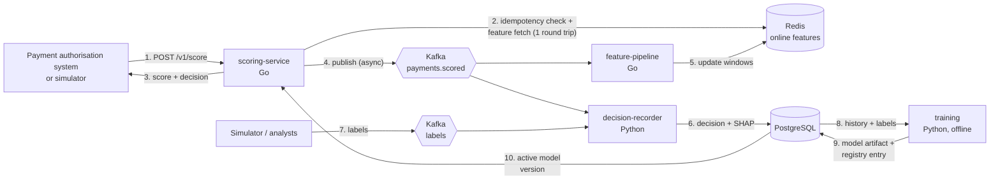
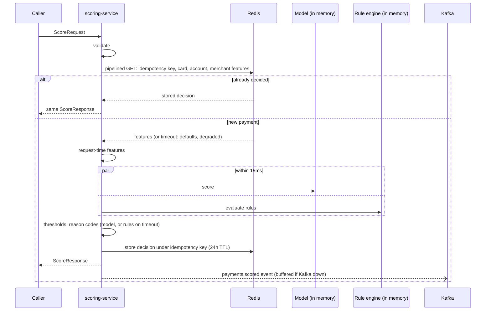

# fraud-detection-ml: Data and Flow

**Status:** draft for discussion. Items marked **[assumption]** need confirmation. Physical schemas (tables, indexes, Redis key layout) are Phase 1 work; this document fixes what data exists, where it comes from, and how it moves.

## 1. Data sources

| Source | Used for | Notes |
|---|---|---|
| IBM TabFormer synthetic card transactions **[assumption]** | Training and the accuracy claim | 24 million records, Apache-2.0 licence (checked on the repository page). Has user, card, time, amount, merchant, merchant location, merchant category, chip use, and fraud label, so behavioural features can be built. Fraud rate, time span, and exact column list to be confirmed on download |
| Payment simulator (ours) | Load tests, failure drills, streaming demos | Unlimited volume, chosen fraud patterns, delayed labels. Produces the same request shape as live traffic |

Two consequences to state openly:

- TabFormer is synthetic. The accuracy figure is "measured on TabFormer", not a claim about real-world card fraud.
- The model is trained on TabFormer, but load tests send simulator traffic. Scores on simulator traffic test latency and plumbing, not accuracy. The simulator matches TabFormer's field set so the same model and features apply. Features TabFormer cannot support (device, precise coordinates) are optional and excluded from the trained model unless the dataset check shows otherwise.

Alternatives considered: the widely used anonymised European card dataset has no card or merchant identifiers, so behavioural features cannot be built from it; IEEE-CIS has richer fields but a competition-only licence; PaySim is mobile money, not card payments.

## 2. End-to-end flow



There are four flows. Only the first is synchronous and latency-critical; everything else happens off the response path.

| Flow | Trigger | Latency class |
|---|---|---|
| A. Scoring | A payment needs a decision | Synchronous, p95 < 25ms |
| B. Feature update | A scored payment is published | Streaming, under 1 second |
| C. Decision recording and explanation | A scored payment is published | Streaming, under 5 seconds |
| D. Labels, training, and model release | Labels arrive; a data scientist trains a model | Batch, minutes to hours |

## 3. Flow A: scoring (what we receive, what we do, what we return)



### What we receive: `POST /v1/score`

```json
{
  "transactionId": "txn-20261019-000918273",
  "cardToken": "tok_8f3a91c2",
  "accountId": "acct-551203",
  "merchantId": "mer-77120",
  "merchantCategory": "5732",
  "merchantZip": "10001",
  "amountMinor": 124999,
  "currency": "USD",
  "eventTime": "2026-10-19T14:03:22.418Z",
  "channel": "ONLINE",
  "entryMode": "CHIP",
  "country": "US",
  "deviceId": "dev-a19f"
}
```

| Field | Rule |
|---|---|
| `transactionId` | Required; unique per payment; the idempotency key |
| `cardToken`, `accountId`, `merchantId` | Required; opaque tokens, never card numbers |
| `merchantCategory` | Required; 4-digit merchant category code |
| `amountMinor` | Required; integer in minor units (cents) to avoid floating-point money; greater than 0 |
| `currency` | Required; ISO 4217 code |
| `eventTime` | Required; when the payment happened; not more than 5 minutes in the future |
| `channel`, `entryMode` | Required; enumerations (`ONLINE`, `IN_STORE`; `CHIP`, `SWIPE`, `KEYED`, `ONLINE`) |
| `merchantZip`, `country`, `deviceId` | Optional; features that depend on them fall back to defaults |

### What we do

1. **Validate.** Reject malformed requests with 400 and the failing field. These are not scored and do not count against availability.
2. **Check idempotency and fetch features** in one pipelined Redis round trip: the stored decision for this transaction ID (if any), and the feature hashes for card, account, and merchant.
3. **Build the feature vector**: online features from Redis plus request-time features computed from the payment (see section 7). Missing values get documented defaults.
4. **Score and evaluate rules in parallel.** The model gets 15ms. The rule engine always runs; its result is used if the model misses the budget or is not loaded.
5. **Decide.** Apply thresholds to the score: below `review` approves, at or above `review` reviews, at or above `decline` declines. Attach reason codes from cheap feature checks (or from the rules that fired, on fallback).
6. **Remember** the decision under the transaction ID for 24 hours, so retries get the same answer.
7. **Respond**, then publish the scored-payment event asynchronously.

### What we return

```json
{
  "transactionId": "txn-20261019-000918273",
  "decision": "REVIEW",
  "score": 0.8312,
  "reasonCodes": ["VELOCITY_1M_HIGH", "AMOUNT_UNUSUAL_FOR_CARD"],
  "modelVersion": "xgb-2026-10-15-01",
  "fallback": false,
  "fallbackCause": null,
  "degraded": false,
  "decidedAt": "2026-10-19T14:03:22.431Z"
}
```

| Status | Meaning |
|---|---|
| 200 | A decision (model, fallback, or degraded); always returned for a valid request |
| 400 | Invalid request; field named in the body |
| 401 | Missing or bad client credential |
| 503 | Only if the instance is shutting down; the caller retries another instance |

## 4. Flow B: feature update

1. `feature-pipeline` consumes `payments.scored`, partitioned by card token so each card's events arrive in order.
2. Duplicates are dropped by transaction ID; events older than the 5-minute lateness limit are counted and skipped.
3. For each entity (card, account, merchant, device) it updates time-bucketed counters by event time, then writes the derived feature values to Redis with an expiry.
4. The payment's own features were read before this update, so each payment is scored on behaviour strictly before it. Training reproduces exactly this rule (point-in-time correctness).

Known limitation: two payments on one card less than about a second apart may be scored before the first one's update lands. Card-testing attacks do exactly this. Whether the scoring path should also increment a short-window counter itself (costing latency) is a Phase 3 decision.

## 5. Flow C: decision recording and explanation

1. `decision-recorder` consumes `payments.scored` and writes the decision row (batched inserts).
2. For model-scored decisions it computes exact SHAP values with XGBoost's built-in tree SHAP, using the logged feature vector and the same model version, and stores the top 10 attributions.
3. Shadow scores, when a candidate is in shadow, are carried on the event and stored alongside.

Because the event carries the exact feature vector used for the decision, the recorder never recomputes features. That logged vector is also the ground truth for the training-serving parity test.

## 6. Flow D: labels, training, and model release

1. **Labels** arrive on the `labels` topic (from the simulator, with realistic delays of days to weeks, or from analysts) and are joined to decisions by transaction ID.
2. **Training** reads payments and labels for a time window, rebuilds features point-in-time by replaying events in order with the Python implementation of the feature specification, trains XGBoost, and evaluates on the later holdout months.
3. **Registration**: the artifact (XGBoost JSON model file), feature list, data window, and metrics go into the model registry as `CANDIDATE`.
4. **Shadow**: the candidate is loaded beside the active model and scores live traffic without affecting decisions.
5. **Promotion** only if it beats the active model on the holdout (FR-26); scoring instances pick up the new active version without restart. **Rollback** re-activates the previous version.

## 7. Feature catalogue (initial)

| Feature | Entity | Source | Definition |
|---|---|---|---|
| `card_txn_count_1m` / `_1h` / `_24h` | card | online | Payments in the window before this one |
| `card_amount_sum_1h` / `_24h` | card | online | Sum of amounts in the window |
| `card_amount_mean_30d` | card | online | Mean amount over 30 days |
| `card_distinct_merchants_24h` | card | online | Distinct merchants in 24 hours |
| `card_seconds_since_last` | card | online | Time since the previous payment |
| `card_km_from_last` | card | online | Distance between merchant locations (zip centroids) of this and the previous payment |
| `card_new_merchant` | card | online | Card has not paid this merchant in 30 days |
| `account_txn_count_24h` | account | online | Payments across all the account's cards |
| `merchant_txn_count_1h` / `_24h` | merchant | online | Merchant activity |
| `device_distinct_cards_24h` | device | online | Cards seen on this device (optional) |
| `amount`, `mcc`, `channel`, `entry_mode`, `hour_of_day`, `day_of_week` | payment | request | Taken from the request |
| `amount_to_card_mean_ratio` | payment | request plus online | `amount / card_amount_mean_30d` |

Features that use labels (for example a merchant's past fraud rate) are left out at first: labels arrive weeks late, so such features are easy to leak in training and hard to keep honest online.

## 8. Event topics

| Topic | Key | Producer | Consumers | Content |
|---|---|---|---|---|
| `payments.scored` | card token | scoring-service | feature-pipeline, decision-recorder | Payment, feature vector, score, shadow score, decision, reason codes, model version, flags, stage latencies |
| `labels` | transaction ID | simulator, analyst tooling | decision-recorder | Transaction ID, label, source, time |

This replaces the three topics in the README sketch: publishing one event per decision (instead of separate transaction and decision events) means the features and the decision can never disagree, and the scoring service makes one write instead of two.

## 9. Stored data

| Store | Data | Key fields |
|---|---|---|
| Redis | Online features per entity | entity key, feature values, window buckets, updated time |
| Redis | Idempotency cache | transaction ID, stored response, 24-hour expiry |
| PostgreSQL | Decision | transaction ID, payment fields, score, decision, reason codes, model version, fallback, degraded, stage latencies, feature vector |
| PostgreSQL | Attribution | transaction ID, feature, value, contribution |
| PostgreSQL | Label | transaction ID, label, source, time |
| PostgreSQL | Model registry | version, artifact location, data window, feature list, metrics, status, promoted time |
| PostgreSQL | Fallback rule | rule ID, condition, decision, reason code, priority, enabled |
| PostgreSQL | Decision thresholds | version, review threshold, decline threshold, active from |
| File store | Model artifacts | XGBoost JSON model per version |

## 10. Retention

| Data | Production retention | Laptop |
|---|---|---|
| Decisions, attributions | 2 years **[assumption]**, partitioned by day | Per benchmark run |
| Labels | Kept with their decisions | Same |
| Online features | Rolling windows; expire automatically | Same |
| Idempotency cache | 24 hours | Same |
| Kafka topics | 7 days | 1 day |
| Models | All versions, for audit and rollback | All |

## 11. Sensitivity

In a real deployment card data falls under payment-industry security rules. Here no card numbers exist; cards, accounts, and devices are opaque tokens, which keeps the design out of that scope by construction. Decision records are still treated as sensitive: role-based access, append-only, no tokens in logs beyond the transaction ID.
