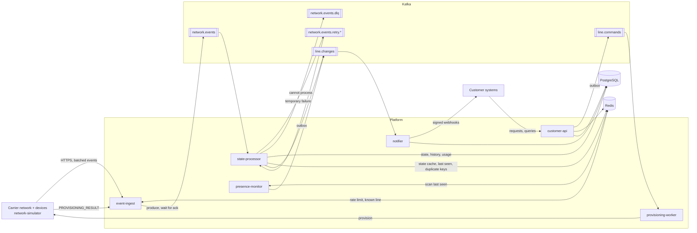

# iot-telemetry-pipeline: High-Level Design

**Status:** draft for review. Built from [how-it-works.md](../requirements/how-it-works.md), the requirements in `../requirements/`, and the decisions in [architecture-decisions.md](../requirements/architecture-decisions.md). Any open question answered differently changes this design.

## 1. System overview

## 2. Services

Six services plus the simulator.

| Service | Responsibility | Scales with | State | Requirements |
|---|---|---|---|---|
| `event-ingest` | Authenticate network and device senders; check shape, size, known line; rate limit; publish; acknowledge | Event rate | None | FR-11 to FR-13 |
| `customer-api` | Customer requests (validate, accept, queue); queries; webhook subscriptions; ops endpoints for dead letters | Request and read rate | PostgreSQL, Redis cache | FR-1 to FR-6, FR-9, FR-22, FR-26 to FR-30, FR-33 |
| `state-processor` | Duplicate and order checks; apply events to line, device and usage state; resolve requests; detect SIM moves; publish changes | Partition count | None (Kafka offsets) | FR-14 to FR-18, FR-31, FR-32 |
| `presence-monitor` | Find lines past their keep-alive window; outage guard (per-region event rate against its usual rate) | Line count | PostgreSQL (`region_outage`, `customer_notice`) | FR-19 to FR-21 |
| `provisioning-worker` | Carry out line commands against the network with retries, time limits and pacing; sweep stuck requests | Command rate | None | FR-7 to FR-10 |
| `notifier` | Deliver webhooks per customer with retries and parking | Notification rate, customer count | PostgreSQL (`notification`) | FR-23 to FR-25 |
| `network-simulator` (test tool) | Network, devices and provisioning system, with a ledger and fault injection | | Its own ledger | [data.md §9](../requirements/data.md#9-simulator) |

## 3. Main flows

The step-by-step versions, with validation order and status codes, are in [data.md §3 and §4](../requirements/data.md#3-how-an-event-is-processed). In short:

**Event (Flows B, C, D):** network or device → `event-ingest` (check, rate limit, publish, ack) → `network.events` keyed by line → `state-processor` (duplicate check, order check, apply, cache, outbox) → `line.changes` → `notifier` → customer webhook.

**Request (Flow A):** customer → `customer-api` (seven checks in order, then request + `PENDING` + command in one outbox write) → `202` → `line.commands` keyed by line → `provisioning-worker` → network → `PROVISIONING_RESULT` back through `event-ingest` → `state-processor` completes the request → `line.changes` → webhook.

**Offline (Flow B):** `presence-monitor` reads the last-seen sorted set in Redis every 10 s, marks lines past their window offline, and publishes changes, unless the line is in an expected silence or a regional outage notice is active.

## 4. Kafka topics

Details (partition counts, message format, retention) are fixed in Phase 2.

| Topic | Key | Producer | Consumer |
|---|---|---|---|
| `network.events` | line ID | event-ingest | state-processor |
| `network.events.retry.5s` / `.1m` / `.10m` | line ID | state-processor | state-processor |
| `network.events.dlq` | line ID | state-processor | customer-api (ops) |
| `line.commands` | line ID | customer-api (outbox) | provisioning-worker |
| `line.changes` | line ID | state-processor, presence-monitor, provisioning-worker (outbox) | notifier |
| `customer.notices` | customer ID | presence-monitor (outbox): outage started and ended | notifier |

## 5. Key design properties

| Property | How it is achieved | Decision |
|---|---|---|
| No acknowledged event or accepted request lost | Ack after a Kafka write confirmed by 2 of 3 replicas; outbox for writes that span the database and Kafka | ADR-004, ADR-007 |
| Per-line order, across reboots | Line ID as partition key; `(bootId, sequence)` and network-time rules | ADR-005 |
| Duplicates harmless; usage exact | Redis duplicate check; usage keyed by `eventId` | ADR-002, ADR-006 |
| Requests never stuck | Time limit plus sweeper; command keyed by line | ADR-007 |
| One customer can't slow others | Per-customer rate limits at the gateways; per-customer webhook delivery | ADR-008 |
| Failure isolation | Retry and dead-letter topics keep a bad event from blocking its partition | |
| Back-pressure | Kafka absorbs bursts; consumer lag is the scaling signal; past a threshold, `503` with `Retry-After` | NFR-24 |

## 6. Scaling

- **event-ingest, customer-api:** stateless, scaled on CPU and request rate.
- **state-processor:** scaled on consumer lag, up to one instance per partition. The partition count sets the ceiling and is fixed in Phase 2.
- **provisioning-worker:** scaled on command backlog, but capped by what the network will accept. Pacing, not instance count, is the limit.
- **notifier:** scaled on delivery backlog, with per-customer concurrency so one slow endpoint uses a bounded share.
- **PostgreSQL:** the likely first bottleneck. Keep-alives don't create rows (data.md §6), history is daily-partitioned, writes are batched, and reads go to a replica at full scale.
- **Redis:** one node locally; clustered at full scale.

## 7. Multi-region design

Each region runs the full stack. Devices and the network reach the nearest healthy region. `network.events` is replicated in both directions, so both regions converge on the same state per line using the ADR-005 ordering rules, without replicating the database. Only a line's home region marks it offline and sends notifications, so customers don't get duplicate alerts. If a region fails, senders resend unacknowledged events to the survivor. Designed here, simulated locally in Phase 6 **[decided, Q6]**.

## 8. Local memory budget

| Component | Memory |
|---|---|
| Kafka, one broker | 1.0 GB |
| PostgreSQL | 0.5 GB |
| Redis | 0.25 GB |
| Six services at about 0.5 GB | 3.0 GB |
| Simulator | 0.5 GB |
| Observability stack (Phase 5) | 1.5 GB |
| **Total** | **about 6.75 GB** |

Failure drills with three brokers add about 2 GB.

## 9. Decisions carried into later phases

1. Message format in Kafka (JSON, Avro or Protobuf) and a schema registry: Phase 2
2. Partition counts for 3x peak: Phase 2
3. Rate-limit algorithm, and avoiding a Redis call per event: Phase 3
4. Processor batch size and commit strategy against the 50 ms budget: Phase 3
5. API contracts for events, requests and webhooks: Phase 3
6. Device, network and customer authentication; webhook signing keys: Phase 4
7. Outage-guard threshold (share of a region's lines silent at once): Phase 3, tuned in Phase 6
