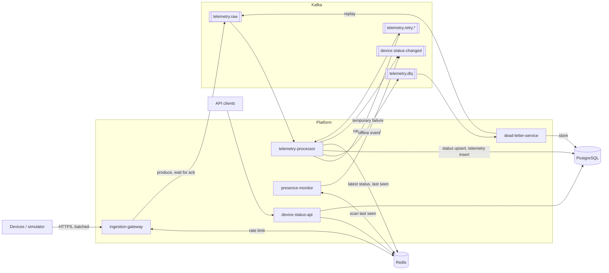

# iot-telemetry-pipeline: High-Level Design

**Status:** draft for discussion. Built on the recommendations in `../requirements/`; any open question answered differently there changes this design.

## 1. System overview

## 2. Services

Five services. This is one more than the first plan proposed: offline detection is split out because it scales differently from event processing.

| Service | Responsibility | Scales with | State |
|---|---|---|---|
| `ingestion-gateway` | Authenticate, check size and shape, rate limit, publish to Kafka, acknowledge | Request rate | None |
| `telemetry-processor` | Validate against the device registry, apply ordering and duplicate rules, write status and telemetry, route failures | Partition count | None (Kafka offsets) |
| `presence-monitor` | Find devices whose heartbeat window has passed and mark them offline | Device count | None (works from Redis) |
| `dead-letter-service` | Store dead-lettered events with their failure reason; inspect and replay | Failure volume | PostgreSQL |
| `device-status-api` | Device registry management; status and history queries | Read rate | PostgreSQL, Redis cache |

One change from the first plan: retries are handled inside `telemetry-processor`, which consumes the retry topics itself. `dead-letter-service` deals only with events that have exhausted their retries.

## 3. Main flows

### 3.1 Ingestion

1. A device sends a batch of events over HTTPS.
2. The gateway authenticates the device and rejects oversized or malformed requests.
3. The gateway checks the device and tenant rate limits in Redis. Over the limit, it answers "slow down" with a retry delay.
4. The gateway publishes each event to `telemetry.raw`, keyed by device ID.
5. Only after Kafka confirms the write does the gateway acknowledge the device. A device that gets no acknowledgement resends.

### 3.2 Processing

1. `telemetry-processor` reads a batch from `telemetry.raw`.
2. For each event it checks the device exists and is active.
3. It writes the telemetry row. A repeat of the same device and sequence number is ignored.
4. It updates the device's latest status, but only if the event's sequence number is higher than the stored one.
5. It refreshes the status cache and the last-seen time in Redis.
6. If the status actually changed, it publishes to `device.status-changed`.
7. It commits the Kafka offset only after the batch is stored.

### 3.3 Failure handling

| Failure type | Example | Action |
|---|---|---|
| Temporary | Database timeout | Send to `telemetry.retry.5s`, then `.1m`, then `.10m` |
| Permanent | Unknown device, invalid payload | Send straight to `telemetry.dlq` |
| Retries exhausted | Still failing after the last tier | Send to `telemetry.dlq` |

Retrying on a separate topic means later events from the same device overtake the failed one. That is safe here because of the sequence rule in step 4: a retried older event can add its telemetry row but can never overwrite newer status.

### 3.4 Offline detection

Redis keeps each device's last-seen time in a sorted structure ordered by time. `presence-monitor` periodically asks for devices whose time is older than their heartbeat window, marks them offline, and publishes the change. A device that reports again is marked online by the normal processing flow.

### 3.5 Reads

Current status is read from Redis, falling back to PostgreSQL on a miss or if Redis is down. History and list queries go to PostgreSQL.

## 4. Key design properties

| Property | How it is achieved |
|---|---|
| No acknowledged event lost | Acknowledge after a Kafka write confirmed by two of three replicas |
| Per-device order | Device ID as partition key |
| Safe duplicates | Telemetry insert ignores a repeated device and sequence; status applies only a higher sequence |
| Failure isolation | Retry and dead-letter topics keep a bad event from blocking its partition |
| Fairness | Rate limits per device and per tenant at the gateway |
| Back-pressure | Kafka absorbs bursts; consumer lag is the scaling signal |

## 5. Scaling

- **Gateway and status API:** stateless, scaled on CPU and request rate.
- **Processor:** scaled on consumer lag, up to one instance per partition. The partition count therefore sets the ceiling and is fixed in Phase 2.
- **PostgreSQL:** the likely first bottleneck. Mitigations are batched writes, time-partitioned telemetry, and read replicas for the query API.
- **Redis:** a single node suffices locally; clustered at full scale.

## 6. Multi-region design

Each region runs the full stack. Devices reach the nearest healthy region. `telemetry.raw` is replicated in both directions between regions, so each region's processor handles both its own and the other region's events. Because status updates depend only on the sequence number, both regions arrive at the same status for every device without replicating the database. If a region fails, devices resend unacknowledged events to the surviving region.

This is designed here and simulated locally in Phase 6.

## 7. Local memory budget

| Component | Memory |
|---|---|
| Kafka, one broker | 1.0 GB |
| PostgreSQL | 0.5 GB |
| Redis | 0.25 GB |
| Five services at about 0.5 GB | 2.5 GB |
| Simulator | 0.5 GB |
| Observability stack (Phase 5) | 1.5 GB |
| **Total** | **about 6.25 GB** |

Failure drills that need three brokers add about 2 GB.

## 8. Decisions carried into the low-level design

1. Blocking or reactive web stack for the gateway, and the Java version
2. Message format in Kafka: JSON, Avro, or Protobuf, and whether to run a schema registry
3. Rate-limit algorithm and how to avoid a Redis call per event
4. Batch sizes and commit strategy in the processor
5. Whether a separate Redis duplicate check is needed, given the database already rejects duplicates
6. Device authentication method
7. API contracts for all three public interfaces
