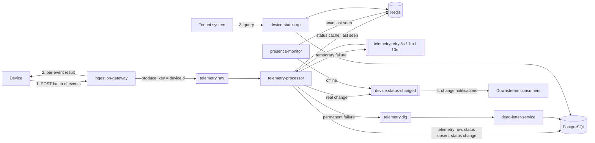

# iot-telemetry-pipeline: Data and Flow

**Status:** draft for discussion. Items marked **[assumption, Qn]** follow the recommended answer to open question n in [open-questions.md](open-questions.md). Items marked **[assumption]** are sizing choices to confirm later.

This document covers what the system receives, what it does with it, what it stores, and what it gives back.

## 1. Flow at a glance



The system returns four things: (1) an acknowledgement per event to the device, (2) current status and history to API callers, (3) status-change events to downstream consumers, and (4) dead-letter records to operators.

## 2. What we receive

### 2.1 Device to gateway

`POST /v1/events`. The device is authenticated by its credentials; the authentication method is decided in Phase 4.

```json
{
  "events": [
    {
      "eventId": "6f1c2a9e-4b7d-4f1a-9c3e-2d8b5a7e1f40",
      "deviceId": "dev-000123456",
      "sequence": 98231,
      "deviceTime": "2026-10-19T14:03:22.418Z",
      "type": "TELEMETRY",
      "metrics": {
        "batteryPct": 81,
        "signalDbm": -71,
        "temperatureC": 36.4,
        "firmware": "4.2.1"
      }
    }
  ]
}
```

| Field | Rule |
|---|---|
| `eventId` | UUID created by the device; used for tracing |
| `deviceId` | Must match the authenticated device. The tenant comes from the registry, never from the payload. |
| `sequence` | A per-device counter that only increases. This is the ordering and de-duplication key. |
| `deviceTime` | Recorded but not trusted for ordering. Rejected if more than 24 hours in the future **[assumption]**. |
| `type` | `TELEMETRY`, `STATUS`, or `HEARTBEAT` |
| `metrics` | A flat map of known metric names; unknown names are ignored. Up to 4 KB per event **[assumption]**. |

Batch limits: up to 100 events or 256 KB **[assumption]**.

### 2.2 Operators and tenant systems

- Device and tenant registration and updates, through `device-status-api`
- Dead-letter replay requests, through `dead-letter-service`

## 3. How it is processed

| Stage | Input | Checks and actions | Writes | On failure |
|---|---|---|---|---|
| 1. Gateway | HTTP batch | Authenticate; check size and shape; check the device and tenant rate limits | Redis rate-limit counters | 401, 400 per event, 429 with `Retry-After` |
| 2. Publish | Valid events | Add `receivedAt` and `tenantId`; produce keyed by device ID; wait for 2 of 3 replicas | `telemetry.raw` | 503; the device resends |
| 3. Validate | Event from Kafka | Device exists and is active | None | Permanent: send to `telemetry.dlq` |
| 4. Store telemetry | Valid event | Insert; a repeat of the same device ID and sequence is ignored | `telemetry` (hourly partitions) | Temporary: send to a retry tier |
| 5. Update status | Valid event | Upsert only if the incoming sequence is higher than the stored one | `device_status`, and `status_change` if the status changed | Temporary: send to a retry tier |
| 6. Cache | Applied status | Refresh the cached status and last-seen time | Redis | Logged; reads fall back to PostgreSQL |
| 7. Notify | Real change | Publish the change event | `device.status-changed` | Retried with the batch |
| 8. Commit | Batch done | Commit the Kafka offset after stages 4 to 7 | Kafka offsets | Batch reprocessed; idempotent |
| Presence | Every 10s **[assumption]** | Find devices past their heartbeat window plus 30s | `device_status`, `status_change`, change event | Next scan catches up |

Timestamps carried on every event: `deviceTime` (from the device), `receivedAt` (gateway), and `processedAt` (processor). Freshness latency (NFR-2) is measured from `receivedAt` until the status is readable.

## 4. What we give back

### 4.1 Acknowledgement to the device

```json
{
  "results": [
    { "sequence": 98231, "status": "ACCEPTED" },
    { "sequence": 98232, "status": "REJECTED", "code": "INVALID_METRIC_TYPE" },
    { "sequence": 98233, "status": "RATE_LIMITED", "retryAfterMs": 2000 }
  ]
}
```

The device drops accepted events from its buffer and resends anything else after the given delay.

### 4.2 Status API

| Query | Endpoint | Source |
|---|---|---|
| Current status of a device | `GET /v1/devices/{id}/status` | Redis, falling back to PostgreSQL |
| Recent history of a device | `GET /v1/devices/{id}/history?from=&to=&cursor=` | PostgreSQL `telemetry` (48h) and `status_change` (90d) |
| Devices by status | `GET /v1/devices?status=OFFLINE&cursor=` | PostgreSQL `device_status`, scoped to the caller's tenant |

```json
{
  "deviceId": "dev-000123456",
  "status": "ONLINE",
  "lastSequence": 98231,
  "lastSeen": "2026-10-19T14:03:22.431Z",
  "metrics": { "batteryPct": 81, "signalDbm": -71, "temperatureC": 36.4, "firmware": "4.2.1" }
}
```

### 4.3 Status-change event

```json
{
  "deviceId": "dev-000123456",
  "tenantId": "tenant-042",
  "from": "ONLINE",
  "to": "OFFLINE",
  "cause": "HEARTBEAT_MISSED",
  "sequence": 98231,
  "changedAt": "2026-10-19T14:12:00.000Z"
}
```

### 4.4 Dead-letter records

Listed and replayed by operators: original event, failure reason, attempt count, and first and last failure times.

## 5. What is stored

| Data | Store | Key | Description |
|---|---|---|---|
| Tenant | PostgreSQL | tenant ID | Name and rate limit **[assumption, Q1]** |
| Device | PostgreSQL | device ID | Tenant, type, firmware, heartbeat interval, active flag, credential hash |
| Telemetry | PostgreSQL, hourly partitions | device ID and sequence | Raw events for 48 hours **[assumption, Q3]** |
| Device status | PostgreSQL and Redis | device ID | One row per device: status, last sequence, last seen, latest metrics |
| Status change | PostgreSQL, monthly partitions | device ID and time | Old status, new status, cause |
| Dead-letter record | PostgreSQL | record ID | Original event, reason, attempts, failure times |
| Last seen | Redis sorted set | device ID, scored by time | Used by `presence-monitor` |
| Rate-limit counters | Redis | device or tenant plus window | Short-lived |
| Raw event log | Kafka | partitioned by device ID | Source of truth for replay |

## 6. Volume

Inputs are **[assumption, Q5]** until confirmed.

| Input | Value |
|---|---|
| Devices | 5 million |
| Peak rate | 50,000 events/sec |
| Average rate | 15,000 events/sec, about one event per device every 5.5 minutes |
| Event size | 500 bytes as JSON |

| Derived figure | Value |
|---|---|
| Peak ingress | 25 MB/sec |
| Events per day | about 1.3 billion |
| Raw data per day | about 650 GB before compression |
| Kafka, 7 days, 3 copies | about 13.6 TB before compression |
| PostgreSQL telemetry, 48 hours | about 2.6 billion rows, roughly 1.3 TB before indexes |
| Latest-status rows | 5 million |

The laptop runs a scaled-down fleet. Its size is set in Phase 6.

## 7. Retention

| Data | Retention |
|---|---|
| Raw events in Kafka | 7 days |
| Telemetry in PostgreSQL | 48 hours **[assumption, Q3]** |
| Device status | Kept while the device is registered |
| Status changes | 90 days **[assumption, Q3]** |
| Dead-letter records | 30 days **[assumption]** |
| Rate-limit counters | Seconds to minutes |

## 8. Sensitivity

Low. The data is device and tenant identifiers plus technical metrics, with no personal data. Device credentials are the only secrets and are stored only as hashes.

## 9. Source

All data is synthetic, produced by `device-simulator`. It generates normal traffic plus deliberate faults: duplicates, out-of-order events, malformed payloads, unknown devices, and devices that go silent.
