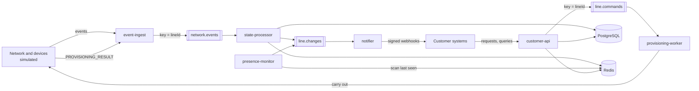

# iot-telemetry-pipeline: Data and Flow

**Status:** draft for review. Items marked **[assumption, Qn]** follow the recommended answer to open question n in [open-questions.md](open-questions.md); **[assumption]** marks sizing choices to confirm later. Example payloads and one tracker's day are in [real-time-data.md](real-time-data.md).

## 1. Flow at a glance

## 2. What comes in

### 2.1 Events from the network and devices

`POST /v1/events`, a batch of up to 100 events or 256 KB **[assumption]**. Every event uses one envelope:

| Field | Rule |
|---|---|
| `eventId` | UUID (v7 recommended) made by the sender; the duplicate key |
| `type` | `DEVICE_ATTACHED`, `DEVICE_DETACHED`, `DEVICE_STATUS`, `KEEP_ALIVE`, `USAGE_RECORD`, `IMEI_CHANGED`, `PROVISIONING_RESULT` |
| `lineId` | The SIM's ICCID. Must be a registered, non-deactivated line. The customer comes from the registry, never from the payload |
| `imei` | The device the SIM is in right now |
| `bootId` | Device boot counter, increases on every restart (device events only) |
| `sequence` | Per-device counter within a boot (device events only) |
| `deviceTime` | Recorded, never used for ordering. Rejected if more than 24 h in the future **[assumption]** |
| `payload` | Type-specific, up to 4 KB **[assumption]** |

Network-originated events (`DEVICE_ATTACHED`, `DEVICE_DETACHED`, `USAGE_RECORD`, `IMEI_CHANGED`, `PROVISIONING_RESULT`) carry the network's own timestamp and no `bootId`/`sequence`; they're ordered by network time per line.

### 2.2 Requests from customers

| Request | Endpoint | Allowed from line state |
|---|---|---|
| Activate | `POST /v1/lines/{iccid}/activate` | `INVENTORY` (embedded/integrated: profile downloaded first) |
| Suspend | `POST /v1/lines/{iccid}/suspend` | `ACTIVE` |
| Restore | `POST /v1/lines/{iccid}/restore` | `SUSPENDED` |
| Deactivate | `POST /v1/lines/{iccid}/deactivate` | `ACTIVE`, `SUSPENDED` |
| Switch profile (P2) | `POST /v1/lines/{iccid}/profile` | `ACTIVE`, `INVENTORY`; embedded/integrated only |
| Bulk job (P1) | `POST /v1/jobs` with an action and up to 50,000 ICCIDs | Per line, as above |
| Subscribe | `PUT /v1/webhooks` | Any |

Every request carries an `Idempotency-Key`.

## 3. How an event is processed

| Stage | Where | Checks and actions | Writes | On failure |
|---|---|---|---|---|
| 1. Accept | event-ingest | Authenticate the sender; check shape and size; known, non-deactivated line; rate limit per customer | Redis rate counters | `401`, `400`/`UNKNOWN_LINE`/`INACTIVE_LINE` per event, `429` with `Retry-After` |
| 2. Publish | event-ingest | Add `receivedAt` and `customerId`; produce keyed by line; wait for 2 of 3 replicas | `network.events` | `503`; sender resends |
| 3. Duplicate check | state-processor | `eventId` seen in the last 48 h? (ADR-006) | Redis `SET NX` with 48 h TTL | Seen: drop. Redis down: fall back to database keys |
| 4. Order check | state-processor | `(bootId, sequence)` or network time newer than stored? (ADR-005) | None | Older: record in history if relevant, never overwrite state |
| 5. Apply | state-processor | Update current state; add to usage total (usage is keyed by `eventId`, so a repeat is a no-op); detect IMEI change; resolve a pending request on `PROVISIONING_RESULT` | `line_state`, `device_state`, `usage_cycle`, `line_history`, `request` | Temporary: retry tier. Permanent: dead letter |
| 6. Cache | state-processor | Refresh cached state and last-seen time | Redis | Logged; reads fall back to PostgreSQL |
| 7. Publish change | state-processor | Only on a real change worth telling: online/offline, threshold crossed, SIM moved, request done | `line.changes` (written in the same transaction as the state, via an outbox) | Retried with the batch |
| 8. Commit | state-processor | Commit the offset after stages 3 to 7 | Kafka offsets | Batch reprocessed; idempotent |

## 4. How a request is processed

| Stage | Where | Checks and actions | On failure |
|---|---|---|---|
| 1. Validate | customer-api | In order: credentials, line belongs to caller, rate limit, idempotency key, state allows the action, no request in progress, account in good standing | `401`, `404`, `429`, original answer, `409 INVALID_STATE`, `409 REQUEST_IN_PROGRESS`, `403 ACCOUNT_BLOCKED` |
| 2. Accept | customer-api | Write `request` (`PENDING`), set line `PENDING`, produce to `line.commands` in one step (outbox) | `503`; nothing changed |
| 3. Carry out | provisioning-worker | Call the network; retry with back-off; pace bulk jobs | Time limit (2 min **[assumption]**) → `FAILED NETWORK_TIMEOUT`, line back to previous state |
| 4. Confirm | state-processor | `PROVISIONING_RESULT` arrives: `DONE` → new line state, request `COMPLETED`; `REJECTED` → previous state, request `FAILED` with the network's reason | |
| 5. Notify | notifier | Webhook: request completed or failed | Retry, then park |

A sweeper fails any request still `PENDING` past its time limit, so a worker killed mid-request can't leave a line stuck (FR-8).

## 5. State models

### Line state

| From | Action or event | To |
|---|---|---|
| `INVENTORY` | activate accepted | `PENDING` → `ACTIVE` on `DONE` |
| `ACTIVE` | suspend accepted | `PENDING` → `SUSPENDED` on `DONE` |
| `SUSPENDED` | restore accepted | `PENDING` → `ACTIVE` on `DONE` |
| `ACTIVE`, `SUSPENDED` | deactivate accepted | `PENDING` → `DEACTIVATED` on `DONE` |
| `PENDING` | `REJECTED` or time limit | back to the state before the request |
| `ACTIVE` | `IMEI_CHANGED` on an embedded/integrated SIM, customer opted in to auto-suspend | `SUSPENDED` |

`DEACTIVATED` is final.

### Connection state

| From | Event | To | Notify? |
|---|---|---|---|
| `OFFLINE` | any device event or `DEVICE_ATTACHED` | `ONLINE` | Yes, unless recovering from an outage notice |
| `ONLINE` | `DEVICE_DETACHED` | `OFFLINE` (`DETACHED`) | Only if the line is `ACTIVE` and no profile switch is in progress |
| `ONLINE` | no event within keep-alive window + 30 s | `OFFLINE` (`KEEP_ALIVE_MISSED`) | Same rule; suppressed during an outage notice (FR-21) |

Default keep-alive windows: trackers 5 min, meters 60 min, fridge sensors 15 min **[assumption]**.

## 6. What we store, and why

Each store serves one of the seven purposes in [how-it-works.md](how-it-works.md#4b-what-we-do-with-the-data). Nothing is kept without one.

| Store | Contents | Purpose | Kept for |
|---|---|---|---|
| PostgreSQL `customer`, `line`, `webhook` | Registry: customer, line, SIM type, plan, keep-alive window, endpoints | All | While active |
| PostgreSQL `line_state` + `device_state` | One row per line: line state, connection, last seen, battery, signal, firmware, IMEI, last `(bootId, sequence)` | 1. Current state | Always |
| PostgreSQL `line_history` | State changes, attach/detach, requests, SIM moves (daily partitions) | 4. Support history | 90 days **[assumption, Q3]** |
| PostgreSQL `usage_cycle` + `usage_record` | Running total per line per cycle; each usage record keyed by `eventId` | 3. Metering | 13 months |
| PostgreSQL `request`, `job` | Every request and bulk job with its outcome | 2, 4 | 90 days |
| PostgreSQL `notification` | Every webhook with delivery attempts | 2. Notifications | 30 days |
| PostgreSQL `security_event` | SIM moves with severity | 6. Security | 1 year |
| PostgreSQL `fleet_minute` | Per customer, region, model: lines online/offline, requests failed | 5. Fleet health | 90 days |
| PostgreSQL `dead_letter` | Unprocessable events with reason | Operations | 30 days |
| Redis | Rate counters, duplicate keys (48 h), state cache, last-seen sorted set | Speed | Short-lived |
| Kafka `network.events` | Every event as received | 7. Replay | 7 days |

Keep-alives and routine status readings are **not** stored row by row: they only update current state and last seen. That's what keeps PostgreSQL to about 10M history rows a day instead of 1.3 billion **[assumption, Q3]**.

## 7. What we give back

| To | What | How |
|---|---|---|
| Device / network | Per-event result: `ACCEPTED`, `REJECTED` with code, `RATE_LIMITED` with delay | Response to `POST /v1/events` |
| Customer | `202` with `requestId` for each request | Response |
| Customer | Webhooks: request completed/failed, device offline/online, usage 80%/100%, SIM moved, outage/recovery, bulk job summary | Signed `POST` to their endpoint, with `notificationId` |
| Customer | Line state, history, request status, line lists | `customer-api` |
| Billing system | Usage totals per line per cycle | Out of scope; exposed as a table and topic |
| Operators | Dead letters, fleet health | Ops endpoints and dashboards |

## 8. Volume

At 5M lines **[assumption, Q5]**: ~15,000 events/s on average and ~50,000/s at peak (breakdown in [real-time-data.md](real-time-data.md#1-where-it-comes-from-and-how-fast)). About 1.3 billion events a day reach Kafka (~650 GB/day at 500 bytes); about 10 million history rows and a few hundred thousand notifications a day reach PostgreSQL.

## 9. Simulator

`network-simulator` plays the network, the devices and the provisioning system. It must produce every event type for all three SIM types, keep a ledger of every acknowledged event and every byte of usage for reconciliation, answer provisioning requests with a configurable delay and failure rate, and inject the faults listed in [real-time-data.md](real-time-data.md#4-the-messy-parts-the-simulator-must-produce) on demand.
