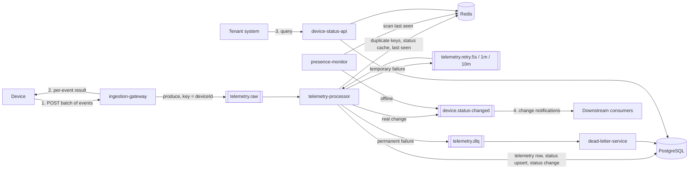

# iot-telemetry-pipeline: Data and Flow

**Status:** draft for discussion. Items marked **[assumption, Qn]** follow the recommended answer to open question n in [open-questions.md](open-questions.md). Items marked **[assumption]** are sizing choices to confirm later.

This document covers what the system receives, what it does with it, what it stores, and what it gives back.

## 1. Flow at a glance



The system returns four things: (1) an acknowledgement per event to the device, (2) current status and history to API callers, (3) status-change events to downstream consumers, and (4) dead-letter records to operators.

## 2. What we receive

### 2.1 Device to gateway

`POST /v1/events`. The device is authenticated by its credentials; the authentication method is decided in Phase 4.

```json
{
  "events": [
    {
      "eventId": "6f1c2a9e-4b7d-4f1a-9c3e-2d8b5a7e1f40",
      "deviceId": "dev-000123456",
      "bootId": 17,
      "sequence": 98231,
      "deviceTime": "2026-10-19T14:03:22.418Z",
      "type": "TELEMETRY",
      "metrics": {
        "batteryPct": 81,
        "signalDbm": -71,
        "temperatureC": 36.4,
        "firmware": "4.2.1"
      }
    }
  ]
}
```

| Field | Rule |
|---|---|
| `eventId` | UUID created by the device; used for tracing |
| `deviceId` | Must match the authenticated device. The tenant comes from the registry, never from the payload. |
| `bootId` | A counter the device increases on every restart and keeps across power loss |
| `sequence` | A counter that increases within one boot and may restart at 0 after a reboot. `(bootId, sequence)` is the ordering and duplicate key (ADR-005, ADR-006). |
| `deviceTime` | Recorded but not trusted for ordering. Rejected if more than 24 hours in the future **[assumption]**. |
| `type` | `TELEMETRY`, `STATUS`, or `HEARTBEAT` |
| `metrics` | A flat map of known metric names; unknown names are ignored. Up to 4 KB per event **[assumption]**. A `STATUS` event may carry `faultCode`. |

Batch limits: up to 100 events or 256 KB **[assumption]**.

The device contract (FR-22): buffer events until acknowledged, resend with backoff on 503 or timeout, honour `Retry-After`, and keep `bootId` and `sequence` as above.

### 2.2 Operators and tenant systems

- Device and tenant registration and updates, through `device-status-api`
- Dead-letter replay requests, through `dead-letter-service`

## 3. Status model

| Status | Meaning | Entered when |
|---|---|---|
| `ONLINE` | Reporting normally | Any event arrives and no other rule applies |
| `DEGRADED` | Reporting, but in poor health | `batteryPct` < 15 or `signalDbm` < -110 **[assumption]** |
| `FAULT` | The device reports a fault | A `STATUS` event carries a `faultCode`; cleared by a `STATUS` event without one |
| `OFFLINE` | Silent past its heartbeat window | `presence-monitor` finds no event within the window plus 30s (FR-13, FR-20) |

Precedence when several rules apply: `FAULT`, then `DEGRADED`, then `ONLINE`. Any event from an `OFFLINE` device moves it out of `OFFLINE`. Each change is recorded with a cause: `EVENT`, `THRESHOLD`, `FAULT_REPORTED`, `FAULT_CLEARED`, `HEARTBEAT_MISSED`, or `REBOOT` (a higher `bootId` arrived).

Default heartbeat windows by device type **[assumption]**: tracker 60s, meter 15 min, sensor 5 min. A device can override its type's default.

## 4. How it is processed

| Stage | Input | Checks and actions | Writes | On failure |
|---|---|---|---|---|
| 1. Gateway | HTTP batch | Authenticate; look up the device in a local registry cache (no database call per event); reject unknown or inactive devices; check size and shape; check the device and tenant rate limits | Redis rate-limit counters | 401, 403, 400 per event, 429 with `Retry-After` |
| 2. Publish | Valid events | Add `receivedAt` and `tenantId`; produce keyed by device ID; wait for 2 of 3 replicas; cap in-flight requests (NFR-24) | `telemetry.raw` | 503; the device resends |
| 3. Validate | Event from Kafka | Device is still active (covers deactivation after the ack) | None | Permanent: send to `telemetry.dlq` |
| 4. De-duplicate | Valid event | Set the Redis key `(deviceId, bootId, sequence)` if absent, TTL 24h. If it was already present, skip stage 5 and go to stage 6 | Redis duplicate key | Redis down: continue; the per-partition unique constraint still catches same-hour repeats |
| 5. Store telemetry | New event | Insert the row | `telemetry` (hourly partitions) | Temporary: send to a retry tier |
| 6. Update status | Event | Apply only if `(bootId, sequence)` is higher than the stored key; derive status from the status model | `device_status`, and `status_change` if the status changed | Temporary: send to a retry tier |
| 7. Cache | Applied status | Refresh the cached status and last-seen time, after the database write | Redis | Logged; reads fall back to PostgreSQL |
| 8. Notify | Real change | Publish the change event | `device.status-changed` | Retried with the batch |
| 9. Commit | Batch done | Commit the Kafka offset after stages 4 to 8 | Kafka offsets | Batch reprocessed; idempotent |
| Presence | Every 10s **[assumption]** | If ingestion is healthy and lag is under 30s, find home-region devices past their window plus 30s | `device_status`, `status_change`, change event | Paused during a platform outage; resumes one heartbeat window after recovery |

Timestamps carried on every event: `deviceTime` (from the device), `receivedAt` (gateway), and `processedAt` (processor). Freshness latency (NFR-2) is measured from `receivedAt` until the status is readable.

## 5. What we give back

### 5.1 Acknowledgement to the device

```json
{
  "results": [
    { "sequence": 98231, "status": "ACCEPTED" },
    { "sequence": 98232, "status": "REJECTED", "code": "INVALID_METRIC_TYPE" },
    { "sequence": 98233, "status": "RATE_LIMITED", "retryAfterMs": 2000 }
  ]
}
```

The device drops accepted events from its buffer and resends anything else after the given delay. A request from an unknown or deactivated device gets 403 for the whole batch.

### 5.2 Status API

| Query | Endpoint | Source |
|---|---|---|
| Current status of a device | `GET /v1/devices/{id}/status` | Redis, falling back to PostgreSQL |
| Recent history of a device | `GET /v1/devices/{id}/history?from=&to=&cursor=` | PostgreSQL `telemetry` (48h) and `status_change` (90d) |
| Devices by status | `GET /v1/devices?status=OFFLINE&cursor=` | PostgreSQL `device_status`, scoped to the caller's tenant |

```json
{
  "deviceId": "dev-000123456",
  "status": "ONLINE",
  "bootId": 17,
  "lastSequence": 98231,
  "lastSeen": "2026-10-19T14:03:22.431Z",
  "metrics": { "batteryPct": 81, "signalDbm": -71, "temperatureC": 36.4, "firmware": "4.2.1" }
}
```

### 5.3 Status-change event

```json
{
  "deviceId": "dev-000123456",
  "tenantId": "tenant-042",
  "from": "ONLINE",
  "to": "OFFLINE",
  "cause": "HEARTBEAT_MISSED",
  "bootId": 17,
  "sequence": 98231,
  "changedAt": "2026-10-19T14:12:00.000Z"
}
```

### 5.4 Dead-letter records

Listed and replayed by operators: original event, failure reason, attempt count, and first and last failure times. A replayed event older than the telemetry retention updates status only (FR-12).

## 6. What is stored

| Data | Store | Key | Description |
|---|---|---|---|
| Tenant | PostgreSQL | tenant ID | Name and rate limit **[assumption, Q1]** |
| Device type | PostgreSQL | type | Default heartbeat window and status thresholds |
| Device | PostgreSQL | device ID | Tenant, type, firmware, heartbeat override, home region, active flag, credential hash |
| Telemetry | PostgreSQL, hourly partitions | device ID, boot ID, sequence (unique within a partition) | Raw events for 48 hours **[assumption, Q3]** |
| Device status | PostgreSQL and Redis | device ID | One row per device: status, last `(bootId, sequence)`, last seen, latest metrics |
| Status change | PostgreSQL, monthly partitions | device ID and time | Old status, new status, cause |
| Dead-letter record | PostgreSQL | record ID | Original event, reason, attempts, failure times |
| Duplicate keys | Redis | device ID, boot ID, sequence | TTL 24 hours (ADR-006) |
| Last seen | Redis sorted set | device ID, scored by time | Used by `presence-monitor` |
| Rate-limit counters | Redis | device or tenant plus window | Short-lived |
| Raw event log | Kafka | partitioned by device ID | Source of truth for replay |

**Full-scale path for telemetry:** 2.6 billion rows in plain PostgreSQL is a stretch for one primary. At full scale, telemetry would move to TimescaleDB, a PostgreSQL extension that keeps the same SQL and adds hypertables, built-in retention, and compression. The laptop build uses plain PostgreSQL with hourly partitions, and the schema is kept compatible with a later switch.

## 7. Volume

Inputs are **[assumption, Q5]** until confirmed.

| Input | Value |
|---|---|
| Devices | 5 million |
| Peak rate | 50,000 events/sec |
| Average rate | 15,000 events/sec, about one event per device every 5.5 minutes |
| Event size | 500 bytes as JSON |

| Derived figure | Value |
|---|---|
| Peak ingress | 25 MB/sec |
| Events per day | about 1.3 billion |
| Raw data per day | about 650 GB before compression |
| Kafka, 7 days, 3 copies | about 13.6 TB before compression |
| PostgreSQL telemetry, 48 hours | about 2.6 billion rows, roughly 1.3 TB before indexes |
| Redis duplicate keys, 24 hours | about 1.3 billion keys at full scale; sized in Phase 1, small at laptop scale |
| Latest-status rows | 5 million |

## 8. Retention

| Data | Retention |
|---|---|
| Raw events in Kafka | 7 days |
| Telemetry in PostgreSQL | 48 hours **[assumption, Q3]** |
| Device status | Kept while the device is registered |
| Status changes | 90 days **[assumption, Q3]** |
| Dead-letter records | 30 days **[assumption]** |
| Duplicate keys | 24 hours |
| Rate-limit counters | Seconds to minutes |

## 9. Sensitivity

Low. The data is device and tenant identifiers plus technical metrics, with no personal data. Device credentials are the only secrets and are stored only as hashes.

## 10. Data source: `device-simulator`

All data is synthetic. No public dataset has millions of devices, per-device ordering keys, or faults on demand, and the drills need all three.

| Capability | Details |
|---|---|
| Fleet model | N devices across tenants and device types. Tenant sizes are skewed, with a few large tenants. |
| Realistic metrics | Battery drains slowly and resets on recharge; signal is noisy around a per-device baseline; temperature follows a daily cycle; firmware changes occasionally |
| Traffic shape | A daily curve with a peak of about 3.3x the average, plus bursts such as a whole tenant reconnecting at once |
| Device lifecycle | Online, silent periods (to trigger offline), reboot (`bootId` increases, `sequence` resets), deactivation, faults reported and cleared |
| Fault injection, each with a configurable rate | Duplicates, out-of-order delivery, malformed payloads, unknown devices, clock skew, a noisy tenant at 10x its limit, poison events that fail processing |
| Device contract | Implements FR-22 exactly: buffering, resend with backoff, `Retry-After` |
| Acknowledgement ledger | Records every acknowledged event, so the drills can reconcile against the database (NFR-6) |
| Reproducibility | A fixed random seed and named scenarios: `steady`, `peak`, `reboot-storm`, `broker-kill`, `gateway-outage`, `noisy-tenant` |
| Laptop scaling | Shorter heartbeat intervals reach a high event rate with fewer devices, for example 50,000 devices at a 10s interval for 5,000 events/sec |

**Optional replay mode.** For realistic metric shapes, the simulator can replay a public dataset as metric input: the Intel Berkeley Research Lab sensor data (54 sensors, real gaps and battery decline) or the Kaggle Environmental Sensor Telemetry Data (3 devices, clean environmental readings). Datasets are downloaded at run time, not stored in the repository, and their licences are checked first.
