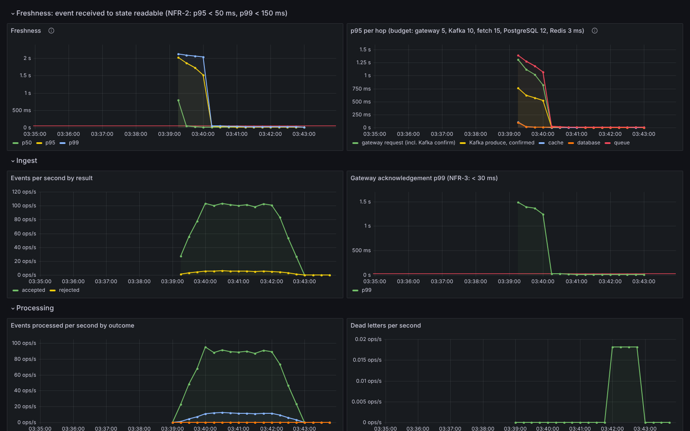

# Observability, local run, 2026-11-11

Part 4: one trace per event across every service, latency for each hop of the 50 ms freshness budget, and a dashboard for the signals NFR-21 lists. Measured in a build container, not on the 16GB laptop; rerun the steps below there.



## What runs

`docker-compose.observability.yml` adds four containers to the usual stack. Together they used about 170 MB in this run; their memory limits add up to about 1.1 GB.

| Container | Address | What it does |
|---|---|---|
| Jaeger | http://localhost:16686 | Stores traces; the services send 10% of them by OTLP (`TRACE_SAMPLING`) |
| Prometheus | http://localhost:9090 | Scrapes every service's `/actuator/prometheus` and kafka-exporter every 5 s, keeps 6 h |
| kafka-exporter | | Consumer lag per group and partition |
| Grafana | http://localhost:3000 | Opens on the "IoT carrier platform" dashboard, no login |

Without the overlay nothing changes: the services keep their metrics endpoints and trace IDs in the logs, and send no spans.

## One trace, end to end (NFR-20)

The Kafka producers now add a `traceparent` header, and state-processor and the notifier continue the trace of the first record in each batch. One trace from this run:

```
+  0.0 ms   5.0 ms  event-ingest     http post /v1/events
+  1.3 ms   3.1 ms  event-ingest     network.events send
+  4.5 ms   8.7 ms  state-processor  network.events process
+  6.0 ms   2.1 ms  state-processor  postgres commit
+  8.1 ms   0.8 ms  state-processor  redis update
+  9.0 ms   3.0 ms  state-processor  line.changes send
+ 12.1 ms   1.5 ms  notifier         line.changes store notifications
```

The state was readable 8.9 ms after the gateway received the event. A batch carries one trace: the other events in it are counted in the metrics, not traced.

## Freshness per hop (NFR-2)

`faults` scenario, 1,000 lines, 180 s, about 100 events/s. The steady part of the run (the last 109 s, 10,097 events):

| Hop | Budget (p95) | p50 | p95 | p99 |
|---|---|---|---|---|
| Gateway request, including the Kafka confirmation | 5 + 10 ms | 3.6 ms | 6.1 ms | 9.3 ms |
| of which Kafka produce, confirmed | 10 ms | 2.8 ms | 4.3 ms | 6.8 ms |
| Received to picked up by the processor (produce, fetch, batching) | 25 ms | 3.6 ms | 7.7 ms | 13.8 ms |
| PostgreSQL transaction, per batch | 12 ms | 1.7 ms | 3.8 ms | 6.2 ms |
| Redis writes, per batch | 3 ms | 0.6 ms | 1.7 ms | 3.5 ms |
| **Freshness: received to readable** | **50 ms** | **7.4 ms** | **13.5 ms** | **21.8 ms** |

The gateway's p99 acknowledgement was 9.3 ms against the 30 ms target (NFR-3).

The first minute is slower. Over the whole run, freshness p95 was 127 ms and p99 1.05 s. In that minute the JVMs are still compiling and the simulator imports 1,000 lines, so each one sends its first events at once. The dashboard shows the spike and when it clears.

## Signals on the dashboard (NFR-21)

| Signal | Metric |
|---|---|
| Freshness and each hop | `iot_freshness_seconds`, `iot_freshness_hop_seconds{hop}`, `iot_ingest_publish_seconds`, `http_server_requests_seconds{uri="/v1/events"}` |
| Ingest by result, including rate-limited | `iot_ingest_events_total{result}` |
| Processed by outcome, dead letters | `iot_state_events_total{outcome}` |
| Consumer lag per partition | `kafka_consumergroup_lag` (kafka-exporter) |
| Request outcomes | `iot_requests_finished_5m{status,reason}`, `iot_requests_pending`, `iot_requests_completion_p95_5m_seconds` |
| Webhooks per customer | `iot_notifier_delivered_total{customer}`, `iot_notifier_attempts_failed_total{customer}`, `iot_notifier_backlog{customer}`, `iot_notifier_backlog_oldest_seconds{customer}` |
| Event to webhook | `iot_notifier_latency_seconds` |
| Offline marking and outages | `iot_presence_offline_marked_total`, `iot_presence_outages_open`, `iot_presence_paused`, `iot_presence_deadlines_repaired_total` |
| Golden signals per service | HTTP rate, 5xx and p95, CPU, heap, Kafka produce errors, each tagged `service` |

All 31 panels returned data in this run, except 5xx (there were none) and repaired deadlines (Redis was not restarted).

The webhook panels showed the dead endpoint as it should look: customer-005 had a backlog of 352 with the oldest 209 s old, and every other customer had none. Event-to-webhook p95 was 2.08 s, above the 2 s target. That comes from the first-minute import burst on a fresh database (see the [2c notes](carrier-2c-run-2026-11-11.md)); the p50 was 30 ms.

## Notes

- Request outcomes are read from `line_request` every 15 s, not counted where requests finish. A request can end in state-processor or in the sweeper, and a count inside a transaction that rolls back would be wrong. Migration V7 adds the index this query needs.
- The `customer` label is fine for 5 customers. With thousands of customers it should become a top-N panel, or the per-customer view should move to logs.
- A full-scale cost projection needs throughput per core, which comes from the load benchmark in part 5.

## Reproduce

```
./mvnw -DskipTests package
docker compose down -v --remove-orphans
docker compose -f docker-compose.yml -f docker-compose.observability.yml up -d --build
mkdir -p target/ledger
docker compose -f docker-compose.yml -f docker-compose.observability.yml --profile sim run --rm -e SCENARIO=faults -e LINES=1000 -e DURATION=180s -e REQUEST_RATE=3 network-simulator
```

Then open http://localhost:3000 for the dashboard and http://localhost:16686 for traces (service `event-ingest`). To trace every event, set `TRACE_SAMPLING` to `1.0` before `up` (in PowerShell: `$env:TRACE_SAMPLING="1.0"`).
