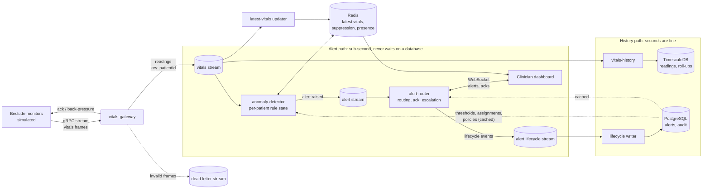
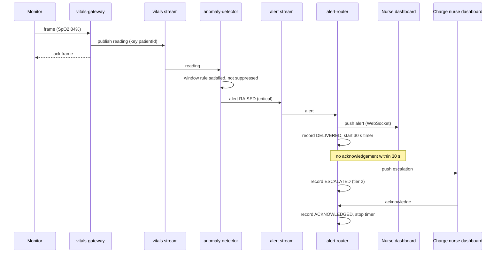

# pulselink-platform: Data and Data Flow

**Status:** draft for discussion. Items marked **[assumption]** are working assumptions and need confirmation. Stream names are provisional; the topic layout is designed in Phase 2 and the schema in Phase 1.

This document answers three questions: what the system receives, what it does with it, and what it gives back.

## 1. Source

All data is synthetic. The `bed-simulator` generates realistic vitals per bed and plays scripted emergencies (falling SpO2, rising heart rate, artefact bursts, monitor disconnects, transfers) with known expected alerts, so the alert path can be tested against a known answer. Patient names and identifiers are generated and never resemble real people.

## 2. End-to-end flow



The alert path only touches Kafka, Redis, and in-memory state. Configuration (thresholds, assignments, escalation policies) is read from PostgreSQL into caches and kept current by change events, so a PostgreSQL outage does not stop alerting.

## 3. What we receive

### 3.1 Vitals frames from monitors

Monitors hold one long-lived gRPC bidirectional stream each **[assumption]**. A frame carries the readings taken at one instant.

```json
{
  "monitorId": "mon-5512",
  "bedId": "icu2-bed-07",
  "sequence": 418822,
  "deviceTime": "2026-10-19T14:03:22.400Z",
  "readings": [
    { "metric": "HEART_RATE", "value": 128, "unit": "bpm", "quality": "GOOD" },
    { "metric": "SPO2",       "value": 88,  "unit": "%",   "quality": "GOOD" }
  ]
}
```

(JSON shown for readability; on the wire this is a Protocol Buffers message.)

| Field | Rule |
|---|---|
| `monitorId`, `bedId` | Must match a registered monitor and the bed it is installed in |
| `sequence` | Increases by one per frame per monitor; used to detect gaps and duplicates |
| `deviceTime` | Required; UTC; used for window rules |
| `metric` | One of `HEART_RATE`, `SPO2`, `BP_SYSTOLIC`, `BP_DIASTOLIC`, `RESP_RATE`, `TEMPERATURE` |
| `value` | Within the physically possible range for the metric (for example heart rate 0 to 350 bpm), otherwise rejected |
| `unit` | Must match the metric's unit of measure |
| `quality` | `GOOD`, `POOR`, or `NO_SIGNAL`; poor-quality readings are stored but do not trigger clinical alerts |

The gateway replies on the same stream with an acknowledgement per frame (or per batch of frames) after the readings are durably in the vitals stream, or with a rejection and a reason code.

### 3.2 Inputs from people

| Input | From | Channel |
|---|---|---|
| Alert acknowledgement | Nurse, charge nurse, physician | WebSocket message from the dashboard |
| Admission, transfer, discharge | Charge nurse (simulated admission system) | REST |
| Bed assignments per shift | Charge nurse | REST |
| Threshold profiles, overrides, escalation policies | Clinical administrator | REST |

## 4. What we do with it

| Step | Service | What happens | Path |
|---|---|---|---|
| 1. Accept | vitals-gateway | Terminate TLS, authenticate the monitor, decode and validate the frame, check the sequence number | Both |
| 2. Enrich | vitals-gateway | Look up the bed's current admission in a local cache and attach the internal patient ID and admission ID; stamp the receive time | Both |
| 3. Publish | vitals-gateway | Write readings to the vitals stream keyed by patient ID (`acks=all`); then acknowledge the frame to the monitor | Both |
| 4. Detect | anomaly-detector | For each reading, update that patient's state (recent values per metric, open windows, last seen time) and evaluate threshold, window, rate-of-change, and signal rules | Alert |
| 5. Suppress | anomaly-detector | If an alert for the same patient and rule is already open or within its suppression window, drop it unless the condition has worsened | Alert |
| 6. Raise | anomaly-detector | Write the alert to the alert stream keyed by patient ID (`acks=all`). From this moment the alert is durable and counts as raised. | Alert |
| 7. Route | alert-router | Find the clinicians assigned to the bed and their open connections; push the alert; record `DELIVERED`; start the escalation timer | Alert |
| 8. Close the loop | alert-router | On acknowledgement record `ACKNOWLEDGED` and stop the timer; on timeout record `ESCALATED` and push to the next tier; on condition clear plus acknowledgement record `RESOLVED` | Alert |
| 9. Watch for silence | anomaly-detector | If a monitor sends nothing for the configured gap (10 s default **[assumption]**), raise a technical "signal lost" alert | Alert |
| 10. Store | vitals-history | Batch readings from the vitals stream into TimescaleDB; continuous aggregates build one-minute and one-hour roll-ups | History |
| 11. Record | lifecycle writer | Write alerts and lifecycle events from the lifecycle stream into PostgreSQL | History |
| 12. Live view | latest-vitals updater | Keep the latest value per patient and metric in Redis and fan out changes to unit dashboards | Live |
| 13. Audit | every service that reads patient data | Append an audit record per access, asynchronously | Side |

### 4.1 Sequence for one critical alert



### 4.2 Time handling

| Concern | Rule |
|---|---|
| Which clock | Window and rate-of-change rules use `deviceTime`. Alert latency is measured from the gateway receive time. |
| Clock skew | The gateway compares `deviceTime` with receive time per monitor; a skew above 2 s **[assumption]** is flagged as a technical issue. |
| Out of order | Readings for one patient are ordered by partition; a frame with an older sequence number than one already seen is treated as a duplicate or reorder and is not re-evaluated. |
| Late readings | Readings more than 5 s late **[assumption]** are stored but do not re-open a closed window. |

## 5. What we give back

| Output | To | Channel | Content |
|---|---|---|---|
| Frame acknowledgement or rejection | Monitor | gRPC stream | Sequence number, accepted or reason code |
| Alert | Assigned clinicians, then escalation tiers | WebSocket | Alert ID, bed, internal patient ID plus display name (dashboard only), rule, severity, triggering value, raised time, escalation tier |
| Alert state change | Everyone who received the alert | WebSocket | Alert ID, new state, who, when |
| Live unit vitals | Clinicians of the unit | WebSocket | Latest value per bed and metric |
| Vitals history | Clinicians of the unit | REST | Raw readings for short ranges, roll-ups for long ranges |
| Alert history | Clinicians of the unit, auditors | REST | Alerts with full lifecycle |
| Audit records | Auditors | REST | Who, patient, action, time, source |
| Metrics and traces | Operators | Prometheus, OpenTelemetry | SLIs, lag, open alerts; internal IDs only |

### Example alert pushed to a dashboard

```json
{
  "type": "ALERT",
  "alertId": "al-01J9Z6Q4K8",
  "patientId": "p-77120",
  "bedId": "icu2-bed-07",
  "rule": "SPO2_LOW_15S",
  "severity": "CRITICAL",
  "value": 84,
  "unit": "%",
  "raisedAt": "2026-10-19T14:03:37.412Z",
  "tier": 1
}
```

The dashboard looks up the patient's display name through an access-controlled, audited call. The name is never in the alert stream.

## 6. Logical streams (provisional)

| Stream | Key | Producer | Consumers | Notes |
|---|---|---|---|---|
| `vitals.readings` | patient ID | gateway | detector, history writer, latest-vitals updater | High volume; short retention (for example 24 h) for replay and catch-up |
| `alerts.raised` | patient ID | detector | router | Low volume; separate from vitals so a vitals backlog never delays an alert |
| `alerts.lifecycle` | alert ID | router | lifecycle writer, router (state rebuild) | Source of truth for open alerts and timers |
| `config.changes` | entity ID | config API | detector, router, gateway | Compacted; keeps caches current |
| `admissions` | bed ID | admission API | gateway, detector | Compacted |
| `*.dlq` | as source | any | operators | Rejected or unprocessable records |

## 7. Entities

| Entity | Description | Key fields | Store |
|---|---|---|---|
| Unit | A hospital ward | unit ID, name, default threshold profile ID | PostgreSQL |
| Bed | A monitored bed | bed ID, unit ID, monitor ID | PostgreSQL |
| Patient identity | Protected identity, kept apart from everything else | internal patient ID, name, record number, date of birth | PostgreSQL, restricted table |
| Admission | A patient's stay in a bed | admission ID, patient ID, bed ID, start, end | PostgreSQL |
| Vital reading | One measurement of one metric | time (device), received time, patient ID, bed ID, metric, value, quality | TimescaleDB hypertable |
| Roll-up | Aggregate per patient, metric, and interval | bucket, patient ID, metric, min, max, avg, count | TimescaleDB continuous aggregate |
| Threshold profile | Limits per metric, as unit default or patient override | profile ID, version, metric, low, high, window seconds, severity | PostgreSQL |
| Alert | A detected condition | alert ID, patient ID, admission ID, rule, severity, value, raised time, state | PostgreSQL (from lifecycle stream) |
| Alert event | One step in an alert's life | alert ID, event type, tier, clinician ID, time | PostgreSQL (from lifecycle stream) |
| Clinician | A nurse or physician | clinician ID, role, unit ID | PostgreSQL |
| Assignment | Which clinician covers which beds in a shift | clinician ID, bed ID, shift start, shift end | PostgreSQL |
| Escalation policy | Who is next if an alert is not acknowledged | severity, tier, role, timeout | PostgreSQL |
| Access audit | One access to patient data | actor, patient ID, action, time, source | PostgreSQL, append-only |
| Latest vitals | Current value per patient and metric | patient ID, metric, value, time | Redis |
| Suppression entry | Open condition per patient and rule | patient ID, rule, severity, last value, expires | Redis, with in-memory fallback |

## 8. Volume

| Figure | Design scale | Laptop **[assumption]** |
|---|---|---|
| Beds | 10,000 | a few hundred, fixed in Phase 8 |
| Frames per bed per second | 2 **[assumption]** | 2 |
| Readings per frame (average) | 5 **[assumption]** | 5 |
| Readings per second | 100,000 | about 5,000 at 500 beds |
| Frames (Kafka messages) per second | 20,000 | about 1,000 at 500 beds |
| Readings per day | about 8.6 billion | about 430 million at 500 beds |
| Raw storage per day | about 860 GB at 100 bytes per stored reading, before compression | |
| Compressed storage per day | about 86 GB, assuming 90% compression typical for time-series data | |
| One-minute roll-up rows per day | about 86 million (10,000 beds × 6 metrics × 1,440 minutes) | |
| Alerts per day | thousands **[assumption]** | |

At this volume raw readings can only be kept for a short time. Longer history comes from roll-ups, which are a small fraction of the size.

## 9. Retention

| Data | Retention | Approximate size at design scale |
|---|---|---|
| Raw readings | 30 days **[assumption]** | about 2.6 TB compressed |
| One-minute roll-ups | 1 year **[assumption]** | a few hundred GB compressed |
| One-hour roll-ups | 7 years **[assumption]** | well under 1 TB |
| Alerts and alert events | 7 years **[assumption]**, as clinical records | small |
| Access audit | 7 years **[assumption]** | small |
| `vitals.readings` stream | 24 hours **[assumption]** | about 860 GB before replication at 100 bytes per reading |

## 10. Sensitivity

High. In a real deployment, patient identity and vitals are protected health information. Although all data here is synthetic, the system is built as if it were real.

| Data class | Examples | Where it may appear |
|---|---|---|
| Direct identifiers | Name, record number, date of birth | Patient identity table and the dashboard view only; never in streams, logs, metrics, or traces |
| Clinical data | Readings, alerts | Streams, databases, dashboards; keyed by internal patient ID |
| Operational data | Monitor IDs, bed IDs, clinician IDs, timings | Everywhere, including logs |
