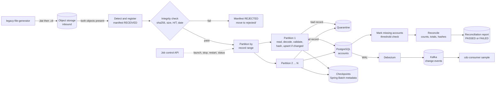

# spring-batch-legacy: Data and Flow

**Status:** draft for discussion. Items marked **[assumption]** follow the recommended answers in [open-questions.md](open-questions.md), or are values still to be confirmed.

This document covers what the system receives, what it does with it, and what it gives back. Table design belongs to phase 1; this document names the data and its rules, not the schema.

## 1. Summary

| | What | Where | Format |
|---|---|---|---|
| **Receives** | One full snapshot of all customer accounts per business day **[assumption: OQ-1, OQ-2]**, plus a control file | Object storage (MinIO locally, S3 in AWS) | EBCDIC fixed-width, 250-byte records; control file in text |
| **Processes** | Integrity check, decode, validate, transform, change detection, upsert, missing-account detection, reconciliation | Spring Batch app | Streaming, in parallel partitions |
| **Gives back** | Current account state, quarantined records, reconciliation report, change events, job status | PostgreSQL, Kafka, job control API | Relational rows, Debezium events, JSON |

## 2. Inputs

### 2.1 Files and naming

The export writes two objects per business day. The data file goes first, the control file last. The control file signals that the data file is complete.

```
inbound/accounts/2026-10-19/ACCTSNAP.D20261019.S000001.dat
inbound/accounts/2026-10-19/ACCTSNAP.D20261019.S000001.ctl
```

`D` is the business date and `S` is the export sequence number. After processing, both objects move to `archive/` or `rejected/` under the same date path.

### 2.2 Control file

Plain text, one key per line, written by the export after the data file.

```
file_name=ACCTSNAP.D20261019.S000001.dat
business_date=2026-10-19
record_count=50000002
byte_size=12500000500
sha256=<64 hex characters>
layout_version=V001
```

`record_count` includes the header and trailer. `byte_size` must equal `record_count × 250`.

### 2.3 Data file structure

Every record is exactly 250 bytes, with no line separators. Encoding is EBCDIC code page 037 **[assumption]**. The first byte is the record type.

```
H  header   exactly 1, first record
D  detail   0..n, one per account
T  trailer  exactly 1, last record
```

### 2.4 Header record

| Pos | Len | Field | COBOL picture | Rule |
|---|---|---|---|---|
| 1 | 1 | Record type | `PIC X(1)` | `H` |
| 2 | 8 | Business date | `PIC 9(8)` | YYYYMMDD; must match the control file |
| 10 | 8 | Source system | `PIC X(8)` | Code list |
| 18 | 6 | File sequence | `PIC 9(6)` | Must match the file name |
| 24 | 4 | Layout version | `PIC X(4)` | Selects the copybook, for example `V001` |
| 28 | 223 | Filler | `PIC X(223)` | Spaces |

### 2.5 Detail record (layout V001)

| Pos | Len | Field | COBOL picture | Target meaning | Validation |
|---|---|---|---|---|---|
| 1 | 1 | Record type | `PIC X(1)` | | `D` |
| 2 | 12 | Account number | `PIC 9(12)` | Natural key | Mandatory, digits only, not all zeros, unique in the file |
| 14 | 40 | Customer name | `PIC X(40)` | Personal data | Mandatory after trimming |
| 54 | 105 | Address lines | `PIC X(35) OCCURS 3` | Personal data, 3 lines | Line 1 mandatory |
| 159 | 10 | Postal code | `PIC X(10)` | Personal data | Mandatory |
| 169 | 2 | Account status | `PIC X(2)` | `AC` active, `SU` suspended, `CL` closed | Code list |
| 171 | 6 | Plan code | `PIC X(6)` | Reference to the plan list | Must exist in the plan list |
| 177 | 6 | Current balance | `PIC S9(9)V99 COMP-3` | Money, 2 decimals, signed | Valid digit and sign nibbles |
| 183 | 5 | Amount due | `PIC S9(7)V99 COMP-3` | Money, 2 decimals, signed | Valid nibbles; ≥ 0 |
| 188 | 8 | Last bill date | `PIC 9(8)` | Date | Valid calendar date, not after the business date; zeros mean never billed |
| 196 | 8 | Account open date | `PIC 9(8)` | Date | Mandatory valid date, not after the last bill date |
| 204 | 2 | Billing cycle day | `PIC 9(2)` | Day of month | 1 to 28 |
| 206 | 4 | Usage minutes | `PIC 9(7) COMP-3` | Count | Valid nibbles; unsigned sign nibble `F` |
| 210 | 1 | Payment method | `PIC X(1)` | `C` card, `B` bank, `N` none | Code list; selects the next field's layout |
| 211 | 20 | Payment details | `PIC X(20)`, `REDEFINES` by method | See below | Must match its method |
| 231 | 20 | Filler | `PIC X(20)` | | Ignored |

Payment details layouts (`REDEFINES`):

| Method | Fields |
|---|---|
| `C` card | Last 4 digits `PIC 9(4)`, expiry MMYY `PIC 9(4)`, filler `PIC X(12)` |
| `B` bank | Routing number `PIC 9(9)`, account last 4 digits `PIC 9(4)`, filler `PIC X(7)` |
| `N` none | All spaces |

Packed decimal sizes: a COMP-3 field with d digits takes ⌈(d + 1) ÷ 2⌉ bytes. So `S9(9)V99` is 11 digits plus a sign, which is 6 bytes. A valid sign nibble is `C` (positive), `D` (negative) or `F` (unsigned).

### 2.6 Trailer record

| Pos | Len | Field | COBOL picture | Rule |
|---|---|---|---|---|
| 1 | 1 | Record type | `PIC X(1)` | `T` |
| 2 | 12 | Detail count | `PIC 9(12)` | Equals the detail records in the file |
| 14 | 9 | Balance total | `PIC S9(15)V99 COMP-3` | Equals the sum of all detail balances |
| 23 | 228 | Filler | `PIC X(228)` | Spaces |

## 3. Processing rules

| Rule | Statement |
|---|---|
| Canonical record | The decoded values in a fixed field order, trimmed, with decimals at fixed scale and dates in ISO format. The record hash is SHA-256 over this form, excluding filler |
| Change detection | A detail record is written only if its account is new or its hash differs from the stored hash **[assumption: OQ-2]** |
| Missing accounts | An account in the table but not in today's snapshot gets `missing_since` set to the business date. It is never deleted **[assumption]** |
| Returning accounts | An account that reappears has `missing_since` cleared and is written as a change |
| Idempotency | Upsert on account number, plus the file ID that last wrote and last confirmed each row **[assumption: OQ-4]** |
| Ordering | Business dates load in order. An older file is refused unless an operator reloads it to roll back |
| Rollback | Reload the last good snapshot. Since each file is complete, reloading it restores the earlier state **[assumption: OQ-4]** |

## 4. Outputs

| Output | Consumer | Content | Rules |
|---|---|---|---|
| Account table | Downstream systems, auditors | One row per account: decoded fields, record hash, last-written file ID, last-seen file ID, `missing_since` | Account number unique |
| Plan reference | Validation | Valid plan codes | Loaded from seed data |
| File manifest | Operators, job logic | One row per file: name, date, sequence, checksum, counts, status, timestamps | Status: `RECEIVED`, `VERIFIED`, `LOADING`, `LOADED`, `RECONCILED`, `FAILED`, `REJECTED` |
| Quarantine | Data owners | Per bad record: file ID, record position, reason code, field, original 250 bytes | Original bytes have restricted access; reports are masked |
| Reconciliation report | Auditors, operators | Counts, control totals, hash mismatches, field differences, `PASSED` or `FAILED` | One per file; personal fields masked |
| Change events | Downstream systems | Debezium envelope with before and after values, operation, commit time and source position | Key = account number; one topic per table |
| Job status and history | Operators | Job, step and partition state, progress, rates | Through the job control API |
| Spring Batch metadata | Job logic | Job and step executions and checkpoints | Owned by Spring Batch |
| Audit log | Auditors | Operator actions | Append-only |

### 4.1 Reconciliation equations

Every one of these must hold for a `PASSED` report.

```
header + trailer + details                    = control.record_count
details                                       = trailer.detail_count
details                                       = accepted + quarantined
accepted                                      = written + unchanged
Σ balance(accepted) + Σ balance(quarantined*) = trailer.balance_total
hash(db row) = hash(source record)            for every accepted record
```

`*` A quarantined record whose balance cannot be decoded is listed separately. The total then holds only if the difference is fully explained by those records; otherwise the report fails.

## 5. End-to-end flow



### 5.1 Step by step

| # | Step | Input | Output | On failure |
|---|---|---|---|---|
| 1 | The export writes the data file, then the control file | | Two objects in `inbound/` | |
| 2 | Detect both objects; register the file in the manifest | Object listing or event | Manifest row `RECEIVED` | Wait; a data file alone is never picked up |
| 3 | Integrity check | Data file, control file | `VERIFIED` | `REJECTED`, nothing written |
| 4 | Plan partitions as record ranges | Record count, partition count | N ranges | |
| 5 | Each partition streams its range: decode, validate, transform, hash | 250-byte records | Canonical records, or quarantine rows | Over the skip threshold: job fails |
| 6 | Compare hashes and upsert changed records in chunks; save the checkpoint in the same transaction | Canonical records | Account rows, checkpoint | Retry transient errors; restart resumes from the checkpoint |
| 7 | Mark accounts missing from the snapshot | Last-seen file ID | `missing_since` set | Above the missing threshold: job fails, nothing marked |
| 8 | Reconcile | Source counts and hashes, database rows | Report | `FAILED` report; data stays for investigation |
| 9 | Debezium streams committed changes | PostgreSQL WAL | Kafka events | Connector catches up from its replication slot |
| 10 | Archive the input objects | | Objects in `archive/` | |

### 5.2 Record lifecycle

```
bytes in file → decoded → valid? ── no ──→ quarantined (reason, original bytes)
                             │
                            yes
                             ↓
                     hash = stored hash? ── yes ──→ unchanged (last-seen file ID updated)
                             │
                             no
                             ↓
                     inserted or updated → change event → reconciled
```

Updating the last-seen file ID on unchanged rows is itself a write. Phase 1 must decide whether it is done per row or as one set-based step after loading, since a per-row update would remove most of the saving from change detection.

## 6. Volume

| Figure | Value | Basis |
|---|---|---|
| Accounts per snapshot | 50 million | Brief |
| Record length | 250 bytes, fixed | Layout V001 |
| Data file size | 12.5 GB | 50 million × 250 bytes |
| Account table with indexes | 15 to 20 GB **[assumption]** | To be measured in phase 1 |
| Changed accounts per day | 2% to 5%, so 1 to 2.5 million **[assumption]** | Generator setting |
| New and missing accounts per day | 0.1% each, so about 50,000 **[assumption]** | Generator setting |
| Change events per day | 1 to 2.5 million | Equal to changed + new + missing |
| Change event size | about 1.5 KB (before and after values in JSON) | To be measured |
| Kafka volume per day | 1.5 to 4 GB | Events × size |
| First full load | 50 million inserts, excluded from change capture **[assumption]** | FR-30 |
| Quarantined records | ≤ 0.1% of records, so ≤ 50,000 | Skip threshold |
| Laptop benchmark size | 5 million records, 1.25 GB file **[assumption: OQ-7]** | NFR section 1.3 |

## 7. Sensitivity

| Data | Class | Handling |
|---|---|---|
| Customer name, address lines, postal code | Personal data | Masked in logs, reports, metrics and API responses |
| Payment details | Partial payment data | Last 4 digits only, by design (NFR-SEC3); masked in reports |
| Account number | Internal identifier | Shown in reports; not considered personal on its own here |
| Balances, dates, usage | Business data | No masking |
| Original bytes in quarantine | Contains all of the above | Restricted table; never logged |

Everything in this project is generated, but the handling above is designed and tested as if it were real.

## 8. Lineage

Every account row can be traced back to its source:

```
account row → last_written_file_id → manifest row → object key in archive/ → record position
```

Every change event carries its commit position, which links it to the load that produced it.
