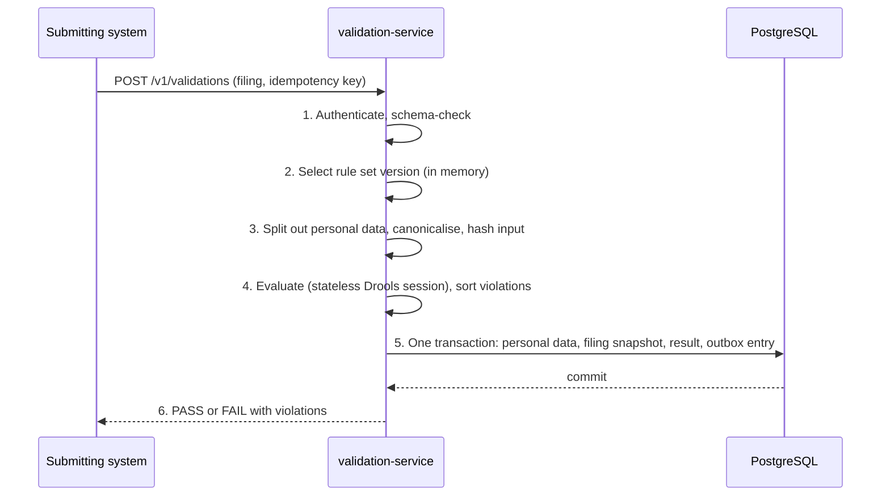

# statutory-validation: Data and Data Flow

**Status:** draft for discussion. Items marked **[assumption]** are working assumptions until confirmed. Items marked **[OQ-n]** follow the recommended answer in [open-questions.md](open-questions.md).

This document covers what the system receives, what it does with it, what it stores, and what it gives back. Table layouts and queries belong to Phase 1.

## 1. Source

All data is synthetic. We write an illustrative rule set of 40 rules **[OQ-4]** for quarterly employer payroll tax returns **[OQ-1]** in three made-up jurisdictions, and generate filings that pass and fail in known ways. The rules resemble real statutory checks in shape but are not taken from any real legal text.

## 2. What we receive

### 2.1 Validation request

Sent by a submitting system. Line items are trimmed here to two of fifty.

```json
{
  "filingId": "fil-2026Q3-004512",
  "jurisdiction": "STATE-A",
  "filingType": "PAYROLL_QUARTERLY",
  "period": "2026-Q3",
  "employerId": "EMP-48120937",
  "employeeCount": 42,
  "totalWages": "612500.00",
  "taxableWages": "598200.00",
  "taxWithheld": "32901.00",
  "lineItems": [
    {
      "lineNo": 1,
      "employeeName": "Example Person",
      "employeeNationalId": "900-12-3456",
      "wages": "14800.00",
      "taxableWages": "14800.00",
      "taxWithheld": "814.00"
    },
    {
      "lineNo": 2,
      "employeeName": "Another Person",
      "employeeNationalId": "900-65-4321",
      "wages": "21000.00",
      "taxableWages": "20100.00",
      "taxWithheld": "1105.50"
    }
  ]
}
```

Headers: `Authorization` (caller identity) and `Idempotency-Key` (FR-17). Money is sent as decimal strings so no value passes through floating point.

| Field | Personal data? | Notes |
|---|---|---|
| filingId, jurisdiction, filingType, period | No | |
| employerId | No | A business identifier **[assumption]** |
| Totals and counts | No | |
| lineItems[].employeeName | **Yes** | Moved to the personal data store before anything is persisted |
| lineItems[].employeeNationalId | **Yes** | Same |
| lineItems[] amounts | No on their own | Stored with the reference, not the person |

### 2.2 Rule set (from Git, through CI) [OQ-5]

| Part | Content |
|---|---|
| Manifest | Jurisdiction, filing type, version number, effective from, effective to, list of rules with ID, severity and message |
| Rules | Drools rule files. Each rule reads the filing and emits violations; it never changes facts or triggers other rules **[OQ-2]** |
| Reference data | Rates, wage caps and ID formats in force for this version. Part of the version, so a replay sees the same numbers |
| Golden cases | Filings with their expected violations |
| Approval metadata | Pull request number, author, approver, merge commit (added by CI) |
| Content hash | SHA-256 over all of the above except approval metadata |

## 3. What we give back

### 3.1 Pass

```json
{
  "evaluationId": "ev-01J9Z6K4R8M2",
  "filingId": "fil-2026Q3-004512",
  "outcome": "PASS",
  "ruleSet": { "id": "STATE-A/PAYROLL_QUARTERLY", "version": 7, "contentHash": "sha256:4be1..." },
  "asOfDate": "2026-10-20",
  "violations": [],
  "resultHash": "sha256:91c0..."
}
```

### 3.2 Fail

```json
{
  "evaluationId": "ev-01J9Z6K4R8M3",
  "filingId": "fil-2026Q3-004513",
  "outcome": "FAIL",
  "ruleSet": { "id": "STATE-A/PAYROLL_QUARTERLY", "version": 7, "contentHash": "sha256:4be1..." },
  "asOfDate": "2026-10-20",
  "violations": [
    { "ruleId": "PAY-012", "severity": "ERROR", "fieldPath": "$.taxWithheld",
      "message": "Tax withheld must equal taxable wages times the rate in force (expected 32901.00)" },
    { "ruleId": "PAY-031", "severity": "WARNING", "fieldPath": "$.lineItems[17].taxableWages",
      "message": "Taxable wages for this employee exceed the annual cap for 2026" }
  ],
  "resultHash": "sha256:7d02..."
}
```

Violations are always ordered by rule ID, then field path (FR-7). Messages refer to fields and amounts, never to names or national IDs.

### 3.3 Errors

| Code | HTTP | Meaning | Audited? |
|---|---|---|---|
| `SCHEMA_INVALID` | 400 | Filing is structurally wrong; every problem is listed | No |
| `NO_RULE_SET` | 422 | No published rule set covers this jurisdiction, filing type and period | No |
| `IDEMPOTENCY_CONFLICT` | 409 | Same idempotency key, different body | No |
| `AUDIT_UNAVAILABLE` | 503 | The evaluation could not be recorded, so no answer is given (retryable) **[OQ-3]** | No (nothing was committed) |

## 4. Data flows

### 4.1 Validate a filing (the hot path)



1. **Receive.** Authenticate the caller. If the idempotency key was seen before with the same body, return the stored result and stop. Parse into exact decimal types and check the schema (FR-15).
2. **Select.** Take the selection date as the first day of the period. From the in-memory index of published versions, pick the highest version whose effective range contains it (FR-3). Fix the as-of date to today's date.
3. **Separate and hash.** Replace each employee's name and national ID with a subject reference. The same employee at the same employer always maps to the same reference, so the personal data store holds one row per person rather than one per filing. Write the tokenised filing in canonical form (RFC 8785 JSON canonicalisation) and take its SHA-256 as the **input hash**. Because the hash covers references rather than names and IDs, erasing personal data later never changes it.
4. **Evaluate.** Run the compiled rule set in a new stateless session against the full filing in memory. Collect violations, sort them, build the result, and take its SHA-256 as the **result hash**.
5. **Record.** In one database transaction, insert any new personal data values, the tokenised filing snapshot, the validation result, and an outbox entry carrying everything the audit record needs. Concurrent requests share commits (group commit) to keep this step short. If the commit fails, answer `AUDIT_UNAVAILABLE` (FR-16).
6. **Return** the result. Personal data was used only in memory during step 4.

### 4.2 Build the audit chain (off the hot path)

1. audit-service, as the single active writer, reads committed outbox entries in commit order, in batches.
2. For each entry it assigns the next sequence number, sets `previousHash` to the last record's hash, computes `recordHash = SHA-256(sequence, evaluationId, inputHash, ruleSet version and content hash, asOfDate, resultHash, caller, time, previousHash)`, and appends the audit record.
3. The append and marking the outbox entry as chained happen in one transaction, so a crash never skips or duplicates a record.
4. On a schedule **[assumption: hourly]**, the current head sequence and hash are written to write-once object storage as an anchor (FR-20).

### 4.3 Publish a rule set [OQ-5]

1. An author changes rules on a branch and opens a pull request (draft becomes in review).
2. CI compiles the rules, runs every golden case, and runs each case twice with fields in a different order to check determinism (FR-12). Any failure blocks the pull request.
3. An approver who is not the author approves; branch protection enforces this (FR-6).
4. On merge, CI builds the versioned bundle, computes its content hash, and calls rule-management with the bundle and the approval metadata.
5. rule-management checks again that author and approver differ, stores the bundle and approval, marks the version published, and announces it through Redis publish/subscribe.
6. Each validation instance downloads the bundle, compiles it, runs a warm-up evaluation, and swaps it into its in-memory index atomically (FR-13). It reports the loaded version (FR-19). Instances that miss the announcement pick it up by polling the database **[assumption: every 10s]**.

### 4.4 Roll back a rule set

An operator retires the bad version through rule-management. The same announcement path removes it from every instance's index, and selection falls back to the previous version (FR-18). Evaluations already made with the bad version stay in the audit trail unchanged.

### 4.5 Replay a past evaluation (FR-11)

1. Look up the audit record and stored snapshot by evaluation ID. If the snapshot is past its retention, report "input no longer available" and stop **[OQ-6]**.
2. Check that the stored snapshot hashes to the recorded input hash.
3. Rehydrate personal data from the personal data store. If it has been erased, report "input no longer available" and stop.
4. Load the recorded rule set version (from memory, or on demand if old) and evaluate with the recorded as-of date.
5. Compare the new result hash with the recorded one and report match or mismatch.

### 4.6 Verify the audit trail (FR-10, FR-20)

Walk a range of records, recompute each record hash, check each `previousHash` link and that sequence numbers have no gaps, and check that every anchor in the range matches the record at its sequence. Report the first break, if any.

### 4.7 Erase personal data (FR-22)

A privacy officer submits an erasure for a subject reference. The values are deleted from the personal data store and the reference is marked erased. Nothing in the snapshot, result or audit tables changes, so the chain still verifies.

## 5. What we store

| Data | Store | Key fields | Personal data? | Retention |
|---|---|---|---|---|
| Rule set version | PostgreSQL + bundle in object storage | rule set ID, version, effective from/to, status, content hash | No | Permanent, so any past result can be replayed |
| Approval | PostgreSQL | rule set version, pull request, author, approver, decision, time | No (staff identities only) | Permanent |
| Golden case | Git | case ID, input, expected violations | No (synthetic) | With the rules |
| Active version index | Redis (announcements) and memory | jurisdiction, filing type, published versions | No | Live state only |
| Filing snapshot | PostgreSQL, compressed | evaluation ID, tokenised canonical input | No (references only) | 90 days live **[OQ-6]** |
| Validation result | PostgreSQL | evaluation ID, filing ID, rule set version, outcome, violations, result hash | No | 1 year live, then archived **[assumption]** |
| Outbox entry | PostgreSQL | evaluation ID, audit fields, chained flag | No | Until chained, plus 7 days **[assumption]** |
| Audit record | PostgreSQL (time-partitioned), older partitions in write-once object storage | sequence, evaluation ID, input hash, rule set version, as-of date, result hash, previous hash, record hash, time | No (hashes and references only) | 7 years **[assumption]** |
| Chain anchor | Write-once object storage | sequence, record hash, time | No | 7 years |
| Personal data | Separate PostgreSQL schema, own encryption key | subject reference, name, national ID, erasure status | **Yes** | Until erased or retention ends |
| Idempotency key | PostgreSQL | key, request hash, evaluation ID | No | 24 hours **[assumption]** |

## 6. Volume

| Figure | Value |
|---|---|
| Peak rate | 5,000 validations/sec (projected) |
| Average rate | 500/sec **[assumption]**, since filings cluster near deadlines |
| Evaluations per day at average | about 43 million |
| Audit record | about 200 bytes, so about 8.6 GB a day and about 22 TB over 7 years |
| Validation result | about 300 bytes, so about 13 GB a day and about 4.7 TB for 1 year live |
| Filing snapshot | about 7 KB raw, about 1.5 KB compressed, so about 65 GB a day and about 5.8 TB for 90 days |
| Personal data | Grows with distinct employees, not filings, because references are reused |

Seven years of audit records cannot all stay in the live database. Recent partitions stay in PostgreSQL; older ones move to write-once object storage, with the chain and its anchors still verifiable across both. On the laptop, a benchmark run produces minutes of data, not days; the figures above are projections.

## 7. Sensitivity

Medium. Filings identify employers and contain employee names and national IDs. Personal data exists in clear only in request memory and in the personal data store. Every other store holds references and hashes.
