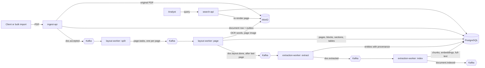

# document-ai-extractor: Data and Data Flow

**Status:** draft for discussion. Items marked **[assumption]** follow the recommended answers in [open-questions.md](open-questions.md) or need confirmation. Topic names, paths, and field names are provisional until the Phase 1 and Phase 2 designs.

This document answers three questions: what the system receives, what it does with it at each step, and what it gives back.

## 1. Source

Public documents only, from sources whose terms permit this use, checked before any download.

**Chosen source: US drug labels from DailyMed [assumption].** Each label is published as SPL XML and can be downloaded as a PDF. The SPL XML marks label sections with standard LOINC codes, so it supplies correct values for most entities. That ground truth is used only for measuring accuracy, never as an input to extraction.

| SPL section (LOINC code) | Used as ground truth for |
|---|---|
| Boxed warning (34066-1) | Boxed warning present, and its text |
| Indications and usage (34067-9) | Indications |
| Dosage and administration (34068-7) | Route and dosage text |
| Contraindications (34070-3) | Contraindications |
| Product data elements (structured, not a section) | Drug names, active ingredients and strengths, dosage form, route, labeler |

DailyMed PDFs nearly all have a text layer. To exercise OCR, a sample of pages is rasterised to images and rebuilt as image-only PDFs, so the same page exists in both forms and OCR quality can be compared directly **[assumption]**.

## 2. What we receive

| Input | Channel | Content | Validation |
|---|---|---|---|
| PDF file | `POST /documents` (multipart) or bulk import from a bucket prefix | 1 to 5 MB typical, up to 50 MB; 1 to 500 pages | PDF signature, not encrypted, parses, within size, page, and render limits |
| Metadata (optional) | Same request, or a manifest file for bulk import | `source`, `externalId` (SPL set ID and version), `documentType` | Known source and type |
| Reviewer correction | `POST /entities/{id}/corrections` | New value, optional new box, comment | Reviewer role; box inside the page |
| Search query | `POST /search` | Text, filters, page size | Length and filter limits |
| Operator command | Operator API | Retry stage, replay dead-letter, reprocess under a new version | Operator role |

## 3. What we give back

| Output | Channel | Content |
|---|---|---|
| Upload receipt | `202 Accepted` | Document ID, duplicate flag, status URL |
| Status | `GET /documents/{id}` | Overall and per-stage status, attempts, errors, timestamps |
| Entities | `GET /documents/{id}/entities` | Values with page, boxes, source text, confidence, versions, correction state |
| Search results | `POST /search` | Ranked chunks with document, page, boxes, highlighted snippet, score |
| Highlighted page | `GET /documents/{id}/pages/{n}/render` | Page image with boxes drawn |
| Event | `document.indexed` topic | Document ID, versions, entity counts, for downstream systems |

## 4. End-to-end flow



Messages carry references (document ID, object keys), never file contents. Every stage reads its input from storage, writes its output to storage, then publishes the next event.

## 5. Stage by stage

| # | Stage | Triggered by | Reads | Does | Writes | Emits |
|---|---|---|---|---|---|---|
| 1 | Accept | Upload or import | Request body | Validate, compute SHA-256, check for duplicate, store file | `originals/{sha256}.pdf`; `document` row; outbox row | `doc.accepted` |
| 2 | Split | `doc.accepted` | Original PDF | Count pages, read page sizes | `page` rows | One `page.tasks` per page |
| 3 | Page | `page.tasks` | Original PDF (one page) | Render, score text layer, OCR if needed, detect blocks, reading order, sections, tables | `pages/{docId}/{n}/ocr.json` and image (OCR pages only); `layout_block`, `section`, `table` rows; page marked done | `doc.layout.done` when the last page of the document finishes |
| 4 | Extract | `doc.layout.done` | Blocks and sections for the document | Run extractor per entity type, attach boxes, check grounding, score confidence | `entity` rows (replacing that document's rows for this version) | `doc.extracted` |
| 5 | Index | `doc.extracted` | Blocks, sections, entities | Chunk by section, embed, write vectors and full-text index | `chunk` rows with embedding and text-search column | `document.indexed` |

Each stage writes a `stage_run` row per attempt. A failed message goes to `<topic>.retry` with back-off, then to `<topic>.dlq` after the last attempt.

**Joining pages back into a document.** Each completed page increments a counter on the document row in the same transaction that writes the page's blocks. The worker that sees the counter reach the page count publishes `doc.layout.done`. A redelivered page task finds the page already done and skips the increment, so the event is published once.

## 6. Coordinates and provenance

- Boxes are stored in PDF points (1/72 inch), origin at the top left of the page, as `x, y, width, height`.
- Each page stores its width and height in points, so a viewer can scale boxes to any image size.
- OCR runs at 300 DPI; OCR pixel boxes are converted by multiplying by 72/300.
- A value that spans lines or columns stores a list of boxes, one per line.

## 7. Extraction schema v1 (drug labels) [assumption]

| Entity type | Cardinality | Example value | Typical location |
|---|---|---|---|
| `BRAND_NAME` | 0..1 | "Amoxil" | Title, highlights |
| `GENERIC_NAME` | 1 | "amoxicillin" | Title |
| `ACTIVE_INGREDIENT` | 1..n | "amoxicillin 500 mg" | Dosage forms and strengths |
| `DOSAGE_FORM` | 1..n | "capsule" | Dosage forms and strengths |
| `ROUTE` | 1..n | "oral" | Title, dosage and administration |
| `INDICATION` | 1..n | "infections of the ear, nose, and throat" | Indications and usage |
| `CONTRAINDICATION` | 0..n | "history of serious hypersensitivity to amoxicillin" | Contraindications |
| `BOXED_WARNING` | 0..1 | Present, with its text | Boxed warning |
| `MANUFACTURER` | 1 | Company name | Last page, "Manufactured by" |
| `REVISION_DATE` | 1 | "2024-03" | "Revised:" line |

## 8. Stored entities

| Data | Store | Key fields |
|---|---|---|
| Document | PostgreSQL | document ID, SHA-256, source, external ID, type, page count, pages done, status, created time |
| Page | PostgreSQL | document ID, page number, width, height, text-layer score, OCR applied, image key |
| Layout block | PostgreSQL | page, block type, boxes, reading order, section, text |
| Section | PostgreSQL | document ID, section type, start and end block |
| Table | PostgreSQL | page(s), box, rows, columns, cells with spans and boxes |
| Entity | PostgreSQL | document ID, entity type, value, normalised value, page, boxes, source text, confidence, extractor version, schema version |
| Correction | PostgreSQL | entity ID, old value, new value, new box, reviewer, time, comment |
| Chunk | PostgreSQL with pgvector **[assumption]** | document ID, section, pages, boxes, text, embedding, full-text vector |
| Stage run | PostgreSQL | document ID, stage, page, attempt, status, duration, error, versions |
| Original PDF | MinIO | `originals/{sha256}.pdf` |
| OCR output and page image | MinIO | `pages/{docId}/{n}/ocr.json`, `pages/{docId}/{n}/image.png` |

## 9. Examples

**Event between stages**

```json
{
  "eventId": "6f1c2a9e-3b0d-4e55-9a51-2f8f1f7c0d11",
  "eventType": "doc.layout.done",
  "eventVersion": 1,
  "documentId": "doc-3c81f0",
  "pageCount": 20,
  "extractorVersion": "layout-v2.1",
  "schemaVersion": "druglabel-v1",
  "occurredAt": "2026-10-20T10:15:02Z"
}
```

**Extracted entity**

```json
{
  "entityId": "ent-91b2",
  "documentId": "doc-3c81f0",
  "entityType": "ACTIVE_INGREDIENT",
  "value": "amoxicillin 500 mg",
  "page": 1,
  "boundingBoxes": [{ "x": 72.0, "y": 188.5, "width": 210.3, "height": 14.2 }],
  "sourceText": "Each capsule contains amoxicillin 500 mg",
  "confidence": 0.94,
  "extractorVersion": "layout-v2.1",
  "schemaVersion": "druglabel-v1",
  "corrected": false
}
```

**Search result**

```json
{
  "query": "oral antibiotic with boxed warning for tendon rupture",
  "tookMs": 64,
  "results": [
    {
      "documentId": "doc-7a10e2",
      "title": "Levofloxacin tablets",
      "page": 1,
      "section": "BOXED_WARNING",
      "snippet": "... increased risk of <mark>tendinitis and tendon rupture</mark> ...",
      "boundingBoxes": [{ "x": 54.0, "y": 120.0, "width": 480.0, "height": 36.5 }],
      "score": 0.0312
    }
  ]
}
```

## 10. Volume

| Figure | Value |
|---|---|
| Documents per hour | 1,000 |
| Pages per hour / per day, if sustained | 20,000 / about 480,000 |
| Original PDFs | 1 to 5 MB each |
| Page images | about 1 MB each at 300 DPI |
| Chunks | about 2 per page, so roughly 1 million a day |
| Embedding storage | about 3 GB a day at 768 dimensions, 4 bytes each |

Storing every page image would add roughly 480 GB a day. Images are therefore kept only for pages that needed OCR, and other pages are re-rendered from the PDF when needed.

On the laptop the pipeline runs a few thousand documents, and OCR on CPU runs well below the target rate. Results are reported as measured plus projected.

## 11. Retention

| Data | Retention |
|---|---|
| Original PDFs | Kept permanently, as the source of truth |
| Page images | 30 days **[assumption]**; regenerated on demand |
| Entities, corrections, chunks | Kept while the document is held; older versions kept until a reprocessing completes |
| Stage runs | 90 days **[assumption]** |
| Dead-letter messages | Until replayed or discarded by an operator |

## 12. Sensitivity

Low. Only public documents are processed, and no personal data is expected. The main risk is malicious files, handled by FR-4 and the security limits in the non-functional requirements.
