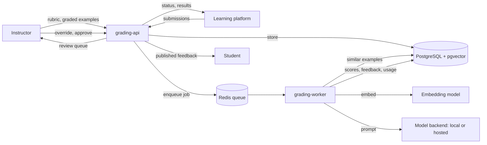
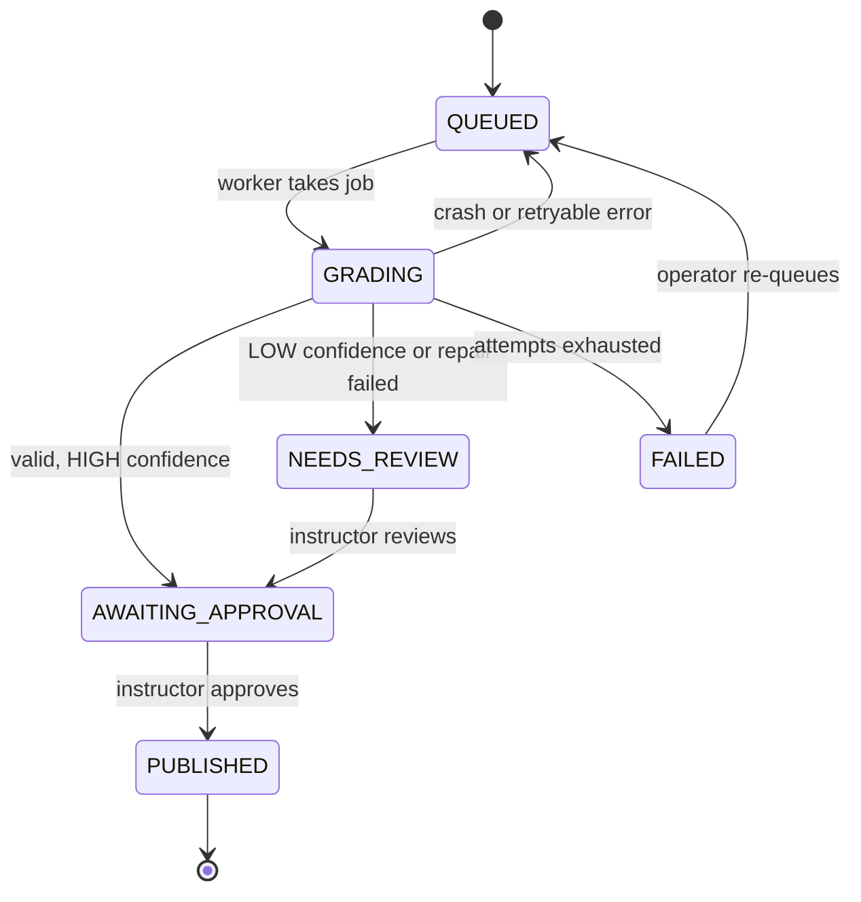

# llm-grading-service: Data and Flow

**Status:** draft for discussion. **[A1]** to **[A5]** are working assumptions from [open-questions.md](open-questions.md); **[assumption]** marks other unconfirmed items.

This document answers three questions: what the service receives, what it does with it, and what it gives back.

## 1. Overview



## 2. What we receive

| Input | From | Format | Validated on arrival |
|---|---|---|---|
| Rubric | Instructor | JSON: criteria, each with ordered levels (points, descriptor) | Structure rules in FR-3 |
| Graded example | Instructor | Text plus a score per criterion | Scores are valid levels of the rubric version |
| Submission | Learning platform | JSON: client submission ID, assignment ID, pseudonymous student ID, text | Non-empty; up to 2,000 words **[assumption]**; UTF-8; no student names expected |
| Override | Instructor | Job ID, criterion ID, new score, reason | Score is a valid level; reason is required |
| Approval | Instructor | Job IDs or an assignment ID | Jobs are in `AWAITING_APPROVAL` or reviewed |

Example submission request:

```json
POST /v1/submissions
{
  "clientSubmissionId": "lms-88231-0491",
  "assignmentId": "asg-transport-2026",
  "studentRef": "stu-5f3a9c",
  "text": "Cities should invest in public transport because it helps everyone. ..."
}
```

Response, returned before any grading:

```json
202 Accepted
{ "jobId": "job-7f21c9", "status": "QUEUED" }
```

## 3. How we process it

### 3.1 Request path (synchronous, target under 200ms)

1. Authenticate the caller and check its access to the assignment.
2. Validate the payload.
3. Look up `clientSubmissionId`. If it exists, return the existing job (FR-5).
4. Compute `contentHash = sha256(normalised text)`.
5. Check the exact-match cache on `(contentHash, rubricVersion, promptVersion, modelVersion)`. On a hit, copy the stored result to a new job in `AWAITING_APPROVAL` and return it (FR-8, **[A3]**).
6. Otherwise, insert the submission and a `QUEUED` job in one database transaction, then enqueue the job ID.
7. Return `202` with the job ID.

If step 6 commits but the enqueue fails, a reconciler later re-enqueues any `QUEUED` job not seen by a worker, so the submission is never lost.

### 3.2 Worker path (asynchronous)

| Step | Action | Output | Failure handling |
|---|---|---|---|
| 1 | Take a job; set status `GRADING`, increment attempts | | Message acknowledged only after step 9 |
| 2 | Load the rubric version and submission | | |
| 3 | Embed the submission with the local embedding model | 384-number vector | Retry |
| 4 | Vector search for the k nearest graded examples in the same rubric version | Examples and similarities | Proceed with zero examples if none exist |
| 5 | Build the prompt: system instructions, rubric, examples, then the submission inside clear delimiters labelled as untrusted data | Prompt, prompt version | |
| 6 | Call the model backend with a timeout | Raw output, token counts | Retry with backoff; fall back to the secondary backend **[A1]**; dead-letter after 3 attempts |
| 7 | Validate: JSON schema, valid level per criterion, evidence quote found verbatim | Parsed result | One repair prompt; on second failure set `NEEDS_REVIEW` |
| 8 | Compute confidence: compare each score with the similarity-weighted example score; add repair and boundary flags | `HIGH` or `LOW` with reasons **[A5]** | |
| 9 | In one transaction: write criterion scores, feedback, confidence, usage record; set status `AWAITING_APPROVAL` or `NEEDS_REVIEW` | Stored result | Write is idempotent on job ID |
| 10 | Fire the callback if registered | | Retried separately; never blocks the job |

### 3.3 Job lifecycle



## 4. What we give back

| Output | To | When |
|---|---|---|
| Job ID and status | Learning platform | Immediately on submit; any time after |
| Full result: scores, justifications, evidence, feedback, confidence | Instructor and platform | Once grading finishes |
| Review queue | Instructor | `NEEDS_REVIEW` jobs, ordered by assignment and deadline |
| Published feedback | Student, through the platform | Only after approval (FR-18) |
| Completion callback | Learning platform | On reaching a review or terminal state |
| Usage and quality reports | Administrator | Queryable per course and per day |

Example result:

```json
{
  "jobId": "job-7f21c9",
  "submissionId": "sub-2026-0491",
  "rubricVersion": 3,
  "promptVersion": "grade-v4",
  "model": "hosted:model-a",
  "criteria": [
    {
      "criterion": "Thesis",
      "score": 3,
      "maxScore": 4,
      "justification": "States a clear position but does not preview the supporting points.",
      "evidence": "Cities should invest in public transport because it helps everyone."
    }
  ],
  "feedback": "Your position is clear. Name your two main reasons in the opening paragraph.",
  "confidence": "HIGH",
  "status": "AWAITING_APPROVAL"
}
```

A student sees only `criteria` (score, maxScore, justification, evidence) and `feedback`, and only after publication. Model, prompt version, and confidence are internal.

## 5. What we store

| Entity | Description | Key fields |
|---|---|---|
| Rubric | Grading scheme, versioned | rubric ID, version, status |
| Criterion | One dimension of a rubric version | criterion ID, rubric ID, version, name, order |
| Level | One score on a criterion | criterion ID, points, descriptor |
| Example | Human-graded anchor submission | example ID, rubric ID, version, text, scores, embedding |
| Assignment | A task given to students | assignment ID, course ID, rubric ID, version, deadline |
| Submission | A student's work | submission ID, client submission ID (unique), assignment ID, student ref, text, content hash, embedding |
| Grading job | One unit of queued work | job ID, submission ID, status, attempts, confidence, confidence reasons, timings |
| Criterion score | Result per criterion | job ID, criterion ID, score, justification, evidence |
| Feedback | Overall comments | job ID, text |
| Override | Instructor change | job ID, criterion ID, old score, new score, reason, instructor, time |
| Usage record | One model call | job ID, backend, model, prompt version, input tokens, output tokens, cost, latency |
| Audit event | Who did what | actor, action, target, time |

The detailed schema, keys, indexes, and queries are Phase 1 work.

## 6. Evaluation dataset

ELLIPSE **[A4]**: about 6,500 essays by English language learners, each scored by humans on six analytic criteria (cohesion, syntax, vocabulary, phraseology, grammar, conventions) on a 1 to 5 scale in half points. Per-criterion scores match the rubric model directly. Fallback: the Kaggle Automated Essay Scoring 2.0 set (holistic 1 to 6 score only). The licence and the size and score figures above must be confirmed against the dataset's own documentation before use.

| Split | Use | Share |
|---|---|---|
| Examples | Graded anchors loaded into the vector index | 20% |
| Development | Prompt and confidence tuning | 20% |
| Test | Held out for the reported QWK | 60% |

## 7. Volume

| Figure | Value |
|---|---|
| Submissions per day in peak season | 100,000 **[assumption]** |
| Essay length | About 500 words, roughly 700 tokens |
| Prompt size | About 3,000 tokens with rubric and two examples |
| Output size | About 500 tokens |
| Tokens per submission | About 3,500 |
| Tokens per day at peak | About 350 million |
| Embedding size | 384 numbers (about 1.5KB) per text |
| Storage per submission | About 10KB including text, result, and embedding |
| Storage per peak day | About 1GB |

At 350 million tokens a day, cost is a real constraint, which is why caching, prompt size, and model choice are design topics.

## 8. Retention

| Data | Retention |
|---|---|
| Submissions and results | Academic term plus appeal period **[assumption]** |
| Overrides and usage records | 2 years **[assumption]**, for quality and cost analysis |
| Rubrics and examples | While in use |
| Audit events | 2 years **[assumption]** |

## 9. Sensitivity

Medium to high. Student work and grades are protected education records in many countries. Students are identified only by pseudonymous IDs inside the service, and no identity information is sent to any model, local or hosted. Submission text is never written to logs.
