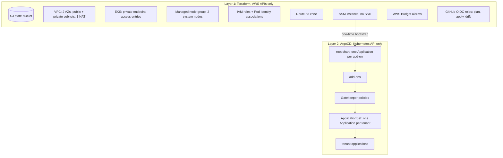

# eks-gitops-platform: Platform Design (Phase 1)

**Status:** draft for discussion. Builds on the [requirements](../requirements/) and the [architecture decisions](../requirements/architecture-decisions.md). Open questions still unanswered use the working assumptions in [open-questions.md](../requirements/open-questions.md).

## 1. Two layers, one boundary



The boundary is strict: Terraform never calls the Kubernetes API (FR-2), and ArgoCD never creates AWS resources other than through controllers that act on its manifests (load balancers, DNS records, nodes, volumes). That is what lets CI work against a private endpoint.

## 2. Repository layout

Everything lives under `track-4-infrastructure/eks-gitops-platform/`, except GitHub workflows, which GitHub only reads from the repository root.

```
eks-gitops-platform/
├── docs/                         requirements, design, ADRs, runbooks
├── terraform/
│   ├── account/                  state bucket, CI roles, budget, DNS zone (kept between sessions)
│   ├── modules/
│   │   ├── network/              VPC, subnets, NAT, tags
│   │   ├── cluster/              EKS, node group, access entries, add-ons
│   │   ├── workload-identity/    IAM roles + Pod Identity associations
│   │   ├── access-host/          SSM-only instance inside the VPC
│   │   ├── ci-identity/          GitHub OIDC provider + plan/apply/drift roles
│   │   └── budget/               AWS Budgets alarms
│   └── envs/
│       ├── dev/                  same modules, dev variables
│       └── prod/                 same modules, prod variables
├── gitops/
│   ├── bootstrap/                ArgoCD values + the root Application, per cluster
│   ├── root/                     Helm chart: renders one Application per add-on
│   │   ├── values-local.yaml     which add-ons, which versions, per cluster
│   │   ├── values-dev.yaml
│   │   └── values-prod.yaml      promotion = changing a version here by PR
│   ├── platform/<add-on>/        our values for each upstream chart
│   ├── policies/                 constraint templates, constraints, gator tests
│   ├── charts/tenant/            Helm chart: everything one tenant gets
│   └── tenants/<cluster>/        one file per tenant = onboarding unit
├── scripts/                      local-up, bootstrap, sync wait, version check
└── tests/                        gator policy suite, live tenancy and drift checks
```

## 3. Clusters and environments

| Cluster | Where | Purpose | Differences |
|---|---|---|---|
| `local` | k3d on the laptop | All GitOps work in Phases 2, 3, 6 | No AWS controllers; self-signed certificates; `*.localtest.me` hostnames; fake secrets provider |
| `dev` | EKS | Every AWS session | Full add-on set |
| `prod` | EKS | Started once to prove promotion (FR-9) | Same modules and charts; only versions and sizes differ |

Promotion: a change merges into `values-dev.yaml`, is verified on dev, then a second pull request copies the same version into `values-prod.yaml`.

## 4. Add-ons and sync order

ArgoCD applies the root chart's Applications in waves; a wave starts only when every Application in the previous wave is Healthy. That requires ArgoCD's health check for `Application` resources, which is switched on in the bootstrap values.

| Wave | Add-on | Namespace | local | AWS | Why this wave |
|---|---|---|---|---|---|
| -3 | Gateway API CRDs (via Envoy Gateway chart) | envoy-gateway-system | yes | yes | Routes need the CRDs |
| -2 | cert-manager | cert-manager | yes | yes | Issuers and certificates come later |
| -2 | External Secrets Operator | external-secrets | yes | yes | Tenants' secret stores come later |
| -2 | AWS Load Balancer Controller | kube-system | no | yes | Envoy's NLB needs it |
| -2 | EBS CSI driver (EKS add-on, by Terraform) | kube-system | no | yes | Prometheus volumes |
| -2 | Karpenter | karpenter | no | yes | Tenant capacity |
| -1 | Envoy Gateway + shared Gateway | envoy-gateway-system | yes | yes | Needs cert-manager for TLS |
| -1 | ExternalDNS | external-dns | no | with a domain | Reads Gateway hostnames (ADR-013) |
| -1 | kube-prometheus-stack | monitoring | yes | yes | Dashboards and alerts |
| -1 | Gatekeeper | gatekeeper-system | yes | yes | Policies come next |
| -1 | Loki | monitoring | yes | yes | Log store (ADR-012) |
| 0 | Alloy, platform alerts and dashboards | monitoring | yes | yes | Need Loki and the monitoring CRDs |
| 0 | Cluster issuers, Karpenter node pools | various | yes | yes | Need their controllers' CRDs |
| 1 | Gatekeeper constraint templates | gatekeeper-system | yes | yes | Constraints need their CRDs |
| 2 | Gatekeeper constraints | — | yes | yes | Must exist before tenants |
| 3 | Tenants ApplicationSet | argocd | yes | yes | Tenants deploy under policy |

The EBS CSI driver and the Pod Identity agent are EKS managed add-ons installed by Terraform, because the node group needs them at creation and they are AWS API objects, not Kubernetes manifests.

## 5. Network

| Element | Choice | Requirement |
|---|---|---|
| VPC | /16, 2 availability zones | FR-1, NFR-16 |
| Subnets | 2 public (load balancers, NAT), 2 private (nodes, endpoint) | FR-1 |
| NAT | 1 gateway, a cost decision | NFR-23, DR table |
| API endpoint | private only | FR-2, NFR-8 |
| Load balancer | 1 NLB for Envoy Gateway, shared by all tenants | NFR-23 |
| Pod networking | VPC CNI with network policy enforcement on | FR-18 |

## 6. Identity map

| Who | Mechanism | Allowed to do |
|---|---|---|
| CI on pull request | GitHub OIDC → `plan` role | Read AWS and state; no writes |
| CI on merge to main | GitHub OIDC → `apply` role, main branch only | Apply Terraform |
| CI on schedule | GitHub OIDC → `drift` role | Read AWS and state |
| Engineer (break-glass) | Own AWS sign-in → SSM session → access host → EKS access entry | Time-limited cluster admin |
| Access host | Instance role + EKS access entry | Cluster admin during bootstrap only |
| ExternalDNS | Pod Identity | Change records in the platform zone only |
| cert-manager | Pod Identity | DNS challenge records in the platform zone only |
| Load Balancer Controller | Pod Identity | Manage the NLB and its target groups |
| Karpenter | Pod Identity | Launch and terminate tagged nodes |
| External Secrets | Pod Identity, then assumes the tenant's role for each SecretStore | Per tenant: read `platform/<env>/<tenant>/*` only |
| ArgoCD | In-cluster service account | Kubernetes only; no AWS access |

## 7. Tenancy model

One file per tenant, `gitops/tenants/<cluster>/<tenant>.yaml`, is the whole onboarding pull request (FR-17). An ApplicationSet turns each file into one Application of the `tenant` chart, which renders:

| Object | Content |
|---|---|
| Namespace | Labels `platform.io/tenant=<name>`, `platform.io/managed=true` |
| ResourceQuota | Size `small` / `medium` / `large` from the tenant file |
| LimitRange | Default requests and limits, so FR-20 never surprises a tenant |
| NetworkPolicies | Default deny in and out; allow same namespace, DNS, the Gateway, and Prometheus scraping |
| RoleBinding | Tenant group gets `edit` in its namespace only |
| AppProject | Source repos the tenant lists; destination only its namespace; no cluster-scoped kinds |
| SecretStore | External Secrets store bound to the tenant's AWS path |
| Applications | One per entry in the tenant file's `apps:` list, in the tenant's project |

## 8. Policy set

Templates come from the Gatekeeper library, pinned by commit. Constraints apply only to namespaces labelled `platform.io/tenant` (ADR-008).

| Constraint | Template | Mode |
|---|---|---|
| No privileged containers | `K8sPSPPrivilegedContainer` | deny |
| Requests and limits required | `K8sRequiredResources` | deny |
| Approved registries only | `K8sAllowedRepos` | deny |
| Required labels `app.kubernetes.io/name`, `owner` | `K8sRequiredLabels` | deny |
| New rules | any | `warn` first, then `deny` by pull request (FR-21) |

Every constraint has a `gator verify` suite with one allowed and one rejected example, run in CI.

## 9. Versions

Chart versions are pinned per cluster in the root chart's values files. The first pinned set is a known-good baseline, not the newest; `scripts/check-chart-versions.sh` lists newer releases, and moving to them is the first change of Phase 2 and the upgrade drill of Phase 7.

## 10. What is still open

| Item | Blocks | Working assumption |
|---|---|---|
| Domain (question 7) | Public DNS and trusted certificates | No domain: internal hostnames and own CA (ADR-013) |
| Budget (question 2) | Phase 4 first apply | $25 a month, alarms at $12 and $25 |
| Notification channel for alerts | Alerts reaching a person | Alerts visible in Alertmanager; a receiver (email or chat webhook) is one Alertmanager config change |
